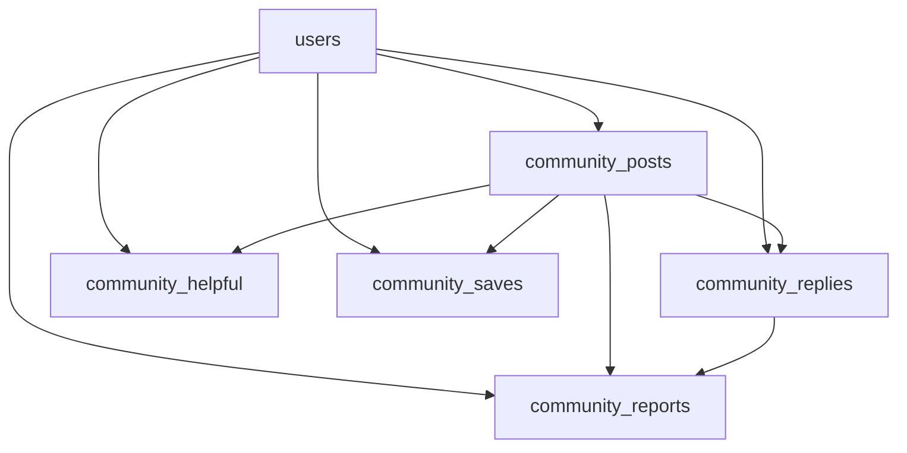
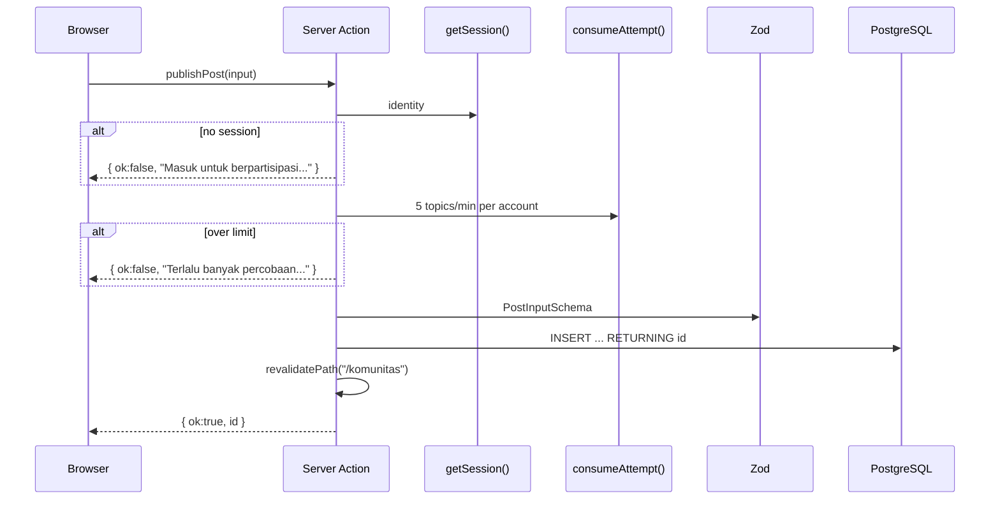

# Community Architecture

Komunitas is the public discussion surface that replaced the retired Darurat,
triage, and PDF features on 9 November 2026. It is competition-scoped: enough to
read, write, react, report, and moderate; not a full forum platform.

Routes: `/komunitas`, `/komunitas/baru`, `/komunitas/[id]`,
`/komunitas/moderasi`.

---

## 1. Domain model



- **Post** — title, body, category, optional source URL, optional seed cover.
- **Reply** — belongs to one post; chronological; paginated 20 per page.
- **Helpful** — one row per account per post; a public counter.
- **Save** — private bookmark; no public counter.
- **Report** — one per reporter per target; reviewed by a moderator.
- **Agent post** — `author_kind = "agent"`, `agent_id` names one of the eight
  detector identities; rendered as "Agen Lumina · <field>".
- **Verified post** — `verified_at` set by a moderator; badge means "reviewed by
  an admin", not "independently fact-checked".

Categories:

| Id | Label | Intent |
| --- | --- | --- |
| `modus-baru` | Modus baru | Share a newly seen pattern. |
| `pertanyaan` | Tanya komunitas | Ask before deciding. |
| `pengalaman` | Berbagi pengalaman | Share what was learned, without blaming victims. |

---

## 2. Permissions

| Action | Guest | Signed-in member | Moderator |
| --- | --- | --- | --- |
| Read feed/detail | Yes | Yes | Yes |
| Search/filter/paginate | Yes | Yes | Yes |
| Create post/reply | No | Yes | Yes |
| Edit own content | No | Yes | Yes |
| Delete own content | No | Yes (soft delete) | Yes |
| Mark helpful | No | Yes | Yes |
| Save | No | Yes | Yes |
| Report | No | Yes | Yes |
| Review reports / hide content | No | No | Yes |
| Verify/unverify agent post | No | No | Yes |

Moderator access is an allowlist of account UUIDs in
`COMMUNITY_MODERATOR_IDS`, checked on every action, never from browser input or
registration. An empty allowlist means no moderators; reports are still stored.

Identity for writes always comes from the session. Email is never printed in
the feed, detail, or public responses. The display name is public.

---

## 3. Read flow

A feed request parses URL query parameters with `QuerySchema`:

```ts
{
  q: string (max 120),
  category?: "modus-baru" | "pertanyaan" | "pengalaman",
  sort: "terbaru" | "ramai" | "belum-dibalas",
  page: 1..10000,
  mine: boolean,
  saved: boolean
}
```

`src/lib/community/store.ts` builds parameterized SQL:

- Only rows with `deleted_at IS NULL` and `hidden_at IS NULL` are public.
- Search matches title/body with a bounded term.
- Sort:
  - `terbaru`: `created_at DESC, id DESC`.
  - `ramai`: reply count + helpful count.
  - `belum-dibalas`: reply count 0.
- Page size 12.
- Detail replies are chronological and paginated 20.
- `hasHelped`, `hasSaved`, `isOwner` are computed for the current session.
- Saved filter reads only the owner's `community_saves`.

The public feed does not expose email or moderation fields.

---

## 4. Write flow

All writes are Server Actions in `src/lib/community/actions.ts`.



Limits per account per minute:

| Action | Limit |
| --- | --- |
| Topic writes | 5 |
| Reply writes | 15 |
| Other actions (delete, helpful, save, report, moderate, verify) | 60 |

### Validation

| Field | Rule |
| --- | --- |
| Title | 10–140 characters. |
| Body (post) | 30–6,000 characters. |
| Body (reply) | 5–3,000 characters. |
| Source URL | Optional; http/https; no username/password; max 1,000. |
| Report reason | `data-pribadi`, `spam`, `berbahaya`. |
| Category | One of three. |

Content is plain text. There is no active HTML/Markdown and no file upload from
members. A source URL is rendered with `nofollow`, `ugc`, `noopener noreferrer`;
Lumina does not fetch it.

The feed composer derives a title from the first line (or the opening text if
the first line is too short) and the timeline does not print that line twice.
The full editor at `/komunitas/baru` includes the source URL field.

---

## 5. Moderation

### Reports

- A member reports a post or reply with a reason.
- Unique partial indexes prevent duplicate reports per reporter/target.
- Reports are not visible to ordinary readers.
- A moderator sees the queue at `/komunitas/moderasi`.
- `moderateContent({ id, kind, hide })` hides or restores content and marks the
  report reviewed.
- Hidden content keeps its row; the author's data is not destroyed by a
  moderation decision.

### Author deletion

- `deleteContent` verifies ownership.
- The original body is cleared and `deleted_at` is set.
- A deleted or hidden post and its replies do not appear publicly.
- The row remains for referential integrity and audit.

### Verification

- `verifyPost` is restricted to `COMMUNITY_MODERATOR_IDS`.
- `verified_at` and `verified_by` record the reviewer.
- Unverifying clears the badge.
- Seed agent posts may set `verified_at` without `verified_by` because they are
  not real admin sessions.

### Agent-authored posts

- `author_kind = "agent"` requires `agent_id`.
- The allowed ids match the eight detector identities.
- Agent accounts use `@agen.lumina`, have no password, and cannot sign in.
- The badge says "reviewed", not "true".

---

## 6. UI architecture

`/komunitas` uses the same `WorkspaceShell` as Companion, Belajar, and Simulasi:

- Left sidebar navigation and account.
- Scrolling content column.
- 340 px right rail with search, community rules, and the moderation door.
- Mobile bottom navigation at narrow widths.

The card/metadata/composer patterns are adapted from
[ccrsxx/twitter-clone](https://github.com/ccrsxx/twitter-clone) (MIT), but the
column framework and blue palette were removed. Colors follow AppNext (orange
brand, light panels, `--lumina-line`); buttons use the shared `Button`
component. The MIT notice is in
[docs/licenses/twitter-clone-MIT.txt](../licenses/twitter-clone-MIT.txt).

Cover images are seed/demo assets under `public/images/community/`. The editor
does not accept uploads; `image_url` is constrained to that prefix and
`image_urls` is capped at 8. Clicking a cover opens a gallery viewer instead of
navigating; the card itself opens the discussion.

---

## 7. Data and seed policy

Migrations:

| File | Adds |
| --- | --- |
| `004_community.sql` | posts, replies, helpful, reports; rewrites the retired Darurat sentence in scenarios. |
| `005_community_images.sql` | `image_url` with local-prefix check. |
| `006_community_gallery.sql` | `image_urls` (max 8) and backfill. |
| `007_community_saves.sql` | private saves. |
| `008_community_agents_verified.sql` | agent authorship and verification. |

Seed commands:

| Command | Purpose | Warning |
| --- | --- | --- |
| `npm run db:seed:community` | Demo members, nine fictional summaries, replies, helpful marks. | Never run on production. |
| `npm run db:seed:community:agents` | Eight agent briefs with existing portraits. | Never run on production. |

Demo data uses `@contoh.lumina`; agent accounts use `@agen.lumina`. Both are
idempotent. Production is expected to contain real member conversations, not
fabricated activity.

---

## 8. Privacy and safety

1. Posting is intentional publication. The form tells the user that content and
   display name are public and asks them to blur victim data.
2. Companion checks and history are never auto-posted. The editor always starts
   empty.
3. Drafts live only in component state; they are not written to localStorage.
4. Email is never rendered publicly.
5. Reports are moderator-only.
6. Saves are private.
7. There is no DM, realtime, email notification, user image upload, karma,
   downvote, topic merge, analytics dashboard, or large CMS.
8. The forum is not positioned as direct incident response; Companion still
   directs victims to banks/account providers through official channels.

---

## 9. Tests

| Suite | Pins |
| --- | --- |
| `src/lib/community/store.test.ts` | Persistence, filters/search, ownership, replies/pagination, unique reactions/reports, review, deletion. |
| `src/lib/community/actions.test.ts` | Session requirement, limits, validation, moderator checks. |
| `src/components/community/community.test.tsx` | Feed, editor, thread, controls. |
| `src/components/community/community-bottom-nav.test.tsx` | Responsive navigation. |

Integration suites require `TEST_DATABASE_URL` ending in `_test` and run
serially.

---

## 10. Known limits

- Competition scope only: no realtime, DMs, notifications, uploads, karma.
- Moderator check is an allowlist of UUIDs; there is no role table or admin UI
  for granting it.
- Email ownership is not verified at registration, which is why the allowlist
  uses UUIDs rather than emails.
- Search is basic SQL matching, not full-text ranking.
- Pagination is offset-based.
- Seed covers are the only images; members cannot upload.
- No edit history is exposed.
