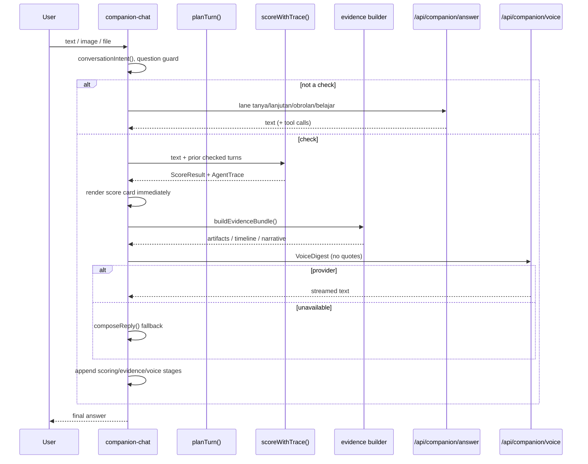

# Companion Architecture

Companion is the entry point to Lumina. It is not a generic chatbot: it routes
each turn deterministically, runs the detection engine locally when the turn is
a check, then optionally asks a model to phrase the answer.

---

## 1. Surfaces

| Surface | File | Role |
| --- | --- | --- |
| Chat workspace | `src/app/(chat)/companion/page.tsx` | Transcript, composer, evidence panel. |
| Chat shell | `src/components/companion/companion-chat.tsx` | Turn orchestration, trace assembly, tool dispatch. |
| Entry | `src/components/companion/companion-entry.tsx` | Quick examples and attachment entry. |
| Agent overview | `src/components/companion/agents-view.tsx` | Pre-run explanation of the crew. |
| Agent detail | `src/components/companion/agents-detail-panel.tsx` | Brief pane for one agent. |
| Trace UI | `src/components/companion/agent-run.tsx` | Orchestrator card + one bubble per stage. |
| Evidence panel | `src/components/companion/panel-ledger.ts`, `signal-panel.tsx` | Signals, findings, verification controls. |
| History | `src/components/companion/session-sidebar.tsx` | Account-scoped metadata list. |
| Report template | `src/components/companion/report-template.tsx` | Deterministic report draft and channel actions. |
| Job tool | `src/components/companion/loker-tool.tsx`, `loker-card.tsx` | Search and per-posting verdicts. |

---

## 2. Lane routing

Routing is pure and deterministic (`src/lib/companion/turn.ts`). It must not be
a model call: a model that routes "Halo, ini dari BCA" to small talk would make
recall a property of the network.

### Lanes

| Lane | Meaning | Runs engine? | Gets score card? |
| --- | --- | --- | --- |
| `periksa` | The user submitted a message/artifact to check. | Yes | Yes |
| `tanya` | A concept question, not a received message. | No | No |
| `lanjutan` | A follow-up to a previous verdict. | No | No |
| `obrolan` | Greeting, story, or request for help. | No | No |
| `belajar` | Tutor request scoped to one module. | No | No |

### Order of decisions in `planTurn()`

1. **Conversation intent** (incident / learning / jobs) — if present, route to
   `obrolan` or `tanya` without scoring.
2. **Question guard** — `isQuestionAbout()` already claimed the turn.
3. **Existing findings** from the current check → `periksa`.
4. **Links** → `periksa`.
5. **Attachments, phone numbers, `.apk`/`.pdf` names** → `periksa`.
6. **Follow-up after a prior verdict** → `lanjutan`.
7. **Money words** → `periksa`.
8. **Long paste (≥ 160 chars)** → `periksa`.
9. **Question shape** → `tanya`.
10. **Greeting** → `obrolan`.
11. Otherwise `obrolan` with the reason "Tidak ada yang bisa diperiksa."

Each plan carries `hasFindings` and a `why` string. The reason is shown in the
UI and is reviewable.

### Guards that prevent false cards

- `isQuestionAbout()` refuses to score a concept question such as "apa itu
  pinjol?". It requires a concept opener, at most two sentences, and no URL,
  phone number, or attachment name.
- `isIncidentNarrative()` detects "aku di-hack / uang hilang" stories and routes
  them to help, not to a 0/Bersih verdict.
- `isContentQuestion()` distinguishes "what does this attachment contain?" from
  "is this safe?".
- `wantsJobSearch()` refuses to run a job search when the user mentions jobs in
  a complaint or negates the request.
- `wantsLearning()` only triggers on a genuine request for course material.

The reason this matters: a victim's story receiving a `0/Bersih` score reads as
"your robbery is not a scam pattern". The guard prevents that category error.

---

## 3. Turn lifecycle



Key property: the verdict and evidence render before the voice call settles. A
slow or dead model never delays the score.

---

## 4. Agent trace

`AgentTrace` is the only contract between the engine and the UI
(`src/lib/contracts/agent-run.ts`).

```ts
interface AgentStage {
  id: StageId;
  label: string;
  task: string;
  status: "menunggu" | "berjalan" | "selesai" | "temuan" | "dilewati" | "gagal";
  findings: number;
  ms: number;
  note?: string;
}

interface AgentTrace {
  stages: AgentStage[];
  totalMs: number;
  validation?: ValidationSummary;
}
```

### The crew

`AGENT_SEQUENCE` in `src/components/companion/agents.ts` is the display order.

| # | id | Name | Stage label | Focus |
| --- | --- | --- | --- | --- |
| 1 | `message` | Mochi | Message Agent | Urgency, authority, lures, OTP/APK asks. |
| 2 | `link` | Bubu | Link Agent | Look-alikes, shorteners, risky TLDs, fake login paths. |
| 3 | `identity` | Piyo | Identity Agent | Sender number, institutional claims, foreign numbers. |
| 4 | `conversation` | Naga | Conversation Agent | Stacked vectors and cross-turn escalation. |
| 5 | `job` | Kiko | Lowongan Agent | Fees, pay-to-earn, overseas placement costs. |
| 6 | `marketplace` | Lala | Marketplace Agent | Off-platform payment, implausible price, fake receipt. |
| 7 | `qris` | Ruru | QRIS Agent | EMVCo TLV, CRC-16, merchant mismatch. |
| 8 | `evidence` | Bao | Evidence Agent | Quotes, amounts, contacts for the report. |

Two stages are not detectors and are not in `AGENT_SEQUENCE`:

- `scoring` — the deterministic engine. Appended by `scoreWithTrace()`.
- `voice` — the language layer. Writes the answer from the digest; never
  re-scores and never adds/removes signals.

### Status semantics

| Condition | Status | Copy |
| --- | --- | --- |
| Findings survive dedupe | `temuan` | `<n> temuan`, warn dot. |
| No findings, detector explained why | `dilewati` | Skip glyph + note. |
| No findings, no note | `selesai` | `Selesai · 0 temuan`. |
| Identity inspected a number but found no claim | `selesai` | `Tidak melapor`. |
| Identity had nothing to inspect | `dilewati` | `Tidak ada nomor untuk diperiksa.` |
| Voice still writing | `berjalan` | Spinner, `menyusun jawaban…`. |
| Transport failure | `gagal` | Failure glyph + note. |

Honesty rules enforced by the UI:

1. Identity may decline to report; that is not a success tick.
2. Evidence and voice never print `0 temuan` or "no pattern found" — they do not
   detect patterns.
3. Evidence is `dilewati` when the bundle has zero artifacts, with the reason.
4. A skipped/failed stage always shows a note; if the trace omitted one, the row
   says `Tidak ada alasan tercatat.`
5. A visible `berjalan` stage always counts as running.
6. Header counts are disjoint: clean + withFindings + skipped + failed =
   specialists. `engineMs = totalMs − voice.ms`.

The expanded row shows the task, full note, mechanism chips, the QRIS caveat,
and only the signals that agent owns.

### Announcements

`runAnnouncement(trace)` is exported by `AgentRun`. The transcript instance uses
`announce={false}`; the shell owns a single live region because opening the
Agents view unmounts the transcript. Only the turn that just settled may
announce; a plain reply cannot re-announce an older check.

---

## 5. Evidence bundle

`src/lib/evidence/` builds `EvidenceBundle`:

```ts
interface EvidenceBundle {
  artifacts: { id; label; kind; value; capturedAt }[];
  timeline: { at; what }[];
  narrative: string;
}
```

Composition:

1. `extract.ts` pulls artifacts (links, amounts, phone numbers, file names,
   quoted lines) from the message.
2. `timeline.ts` orders events.
3. `narrative.ts` writes 2–4 plain sentences.
4. `bundle.ts` assembles and returns `EMPTY_BUNDLE` when there is nothing.

Privacy rule: OTP codes are deliberately **not** extracted, because the bundle
historically left the device as a PDF. Even though PDF export is gone, the rule
remains: a report must not contain a live secret.

The Evidence Agent is a producer, not a detector. It reports `dilewati` when
there are no artifacts.

---

## 6. Language layer

### 6.1 Voice

`POST /api/companion/voice` receives `VoiceDigest`:

```ts
{
  risk, score, modusName,
  findings: [{ label, weight }],   // no evidence quote
  advice, moduleNo, locale: "id"
}
```

The route is `.strict()`, so an extra `evidence` key is rejected. The system
prompt says: "You receive CHECK RESULTS, not the user's message. Never claim to
have read the message." Output is 1–3 sentences, no markdown, no numbered list.

Failure: any non-200 or timeout settles as `dilewati` and the client uses
`composeReply()` from `src/lib/companion/reply.ts`.

### 6.2 Conversational answer

`POST /api/companion/answer` handles `tanya`, `lanjutan`, `obrolan`, `belajar`.
It receives the user's own question, filtered chat history, an optional digest,
public module facts, and public tactic facts. It never receives the checked
message.

The `belajar` lane loads the published module and returns a module-grounded
tutor answer; its fallback is deterministic (`tutorFallback`). The route also
returns validated tool calls:

- `job_search({ query, location?, salaryMin?, salaryMax?, hideFlagged? })`
- `report_draft({ channel? })`

Tool calls are re-validated locally. Unknown names, non-function calls, invalid
arguments, or extra keys are dropped.

### 6.3 Vision

`POST /api/companion/vision` transcribes visible text from an image. It has no
score/risk/signal fields. The client must feed the text back into
`scoreText()`. The system prompt says to copy links, phone numbers, amounts, and
file names exactly; no judgment.

### 6.4 Report polish

`POST /api/companion/tools/report` rewrites tone only. It must preserve every
`[BLANK]`. If the model drops a blank, `requestReportPolish()` returns null and
the deterministic draft wins.

### 6.5 Job summary

`POST /api/companion/tools/summary` receives up to 20 posting titles,
companies, Sentinel status, and Lumina risk labels. The server derives
recommendation counts and instructs the model to repeat them. The schema has no
query, description, apply URL, or saved list.

---

## 7. Tools and cards

| Tool | Trigger | Client behavior |
| --- | --- | --- |
| `job_search` | Explicit request to find jobs. | Opens `LokerTool`; filtering happens in the browser against the RSC snapshot. |
| `report_draft` | Explicit request for a report/template. | Opens `ReportTemplate` on the last `ScoreResult`; ignores the call if no prior verdict. |

The model chooses **whether** to open a card. It never writes the report body
or fetches postings itself.

---

## 8. Conversation history

`companion_conversations` stores metadata only:

- `id`, `user_id`, `title`, `turns`, `risk`, timestamps.

It does not store messages, attachments, or transcripts. Titles are sanitized
to a public allowlist; older titles that copied message excerpts were reset by
migration `010_companion_private_titles.sql`.

Opening history on another device restores titles, not content. The transcript
is lost when the tab closes.

---

## 9. Privacy matrix

| Data | Stays on device | Leaves device | Notes |
| --- | --- | --- | --- |
| Checked message text | Yes | Never | No outbound schema has a field for it. |
| Evidence quotes | Yes | Never | `VoiceDigest` omits `evidence`. |
| Score/risk/signals | Yes (computed) | Digest only | Labels and weights, not quotes. |
| User's own question | — | Yes, when AI is used | Necessary for conversation. |
| Chat history | Device memory | Filtered chat turns only | Checked turns are excluded. |
| Image bytes | — | Yes, opt-in vision | Transcribed text returns; no verdict. |
| Report draft fields | Device | Yes, only on "Rapikan" | No message, quotes, or score. |
| Job search query | Browser | Never to a search endpoint | Model may derive it from the user's own question; filtering is local. |
| Link, when verifying | Device | URL only | Never the message or score. |
| Community content | — | Public by design | User intentionally publishes. |

Threat model and controls: [security-privacy.md](security-privacy.md).

---

## 10. Failure modes

| Failure | Behavior |
| --- | --- |
| LLM URL/model unset | `503 not-configured`; template fallback; score unchanged. |
| LLM timeout | `503 upstream-timeout`; template fallback. |
| LLM returns empty text | `503 upstream-empty` (answer/voice) or deterministic tutor fallback. |
| Vision fails | Filename-only check remains; user is told text could not be read. |
| Report polish fails | Deterministic draft is used. |
| Job summary fails | `kalimatRekomendasi()` states the engine counts. |
| Database unavailable | Detection and templates still work; accounts/history/community/jobs do not. |
| Evidence empty | Evidence Agent is `dilewati`, not "0 findings". |

---

## 11. Tests

| Suite | Pins |
| --- | --- |
| `src/lib/companion/turn.test.ts` | Lane order, guards, paste threshold, follow-up behavior. |
| `src/lib/companion/intent.test.ts` | Incident/learning/jobs recognition and negation. |
| `src/components/companion/agent-run.test.tsx` | Status words, glyphs, arithmetic, notes, attribution, announcement. |
| `src/components/companion/agent-run-reduced.test.tsx` | Reduced-motion tree. |
| `src/components/companion/agents.test.ts` | Registry completeness, labels mirror contracts. |
| `src/components/companion/companion-chat.test.tsx` | Trace only for checked turns, evidence skipped at zero artifacts, voice fallback, digest privacy. |
| `src/components/companion/companion-shell.test.tsx` | Agent count and overview. |
| `src/components/companion/*.test.tsx` | Score card, evidence text, link verification, report template, job card. |

Commands:

```bash
npm test -- src/components/companion src/lib/companion
npm test -- src/lib/scoring
npm run verify
```

---

## 12. Known limits

1. Detectors are synchronous; only voice is genuinely live.
2. Voice is best-effort.
3. Heuristics are tuned for Indonesian text; they are not a general classifier.
4. The Agents overview is explanatory, not a control surface.
5. The companion cannot read PDFs, documents, or code attachments; it checks
   filenames and images only.
6. A follow-up without new evidence is answered from the prior explanation, not
   re-scored.
7. History metadata is not a transcript backup.
