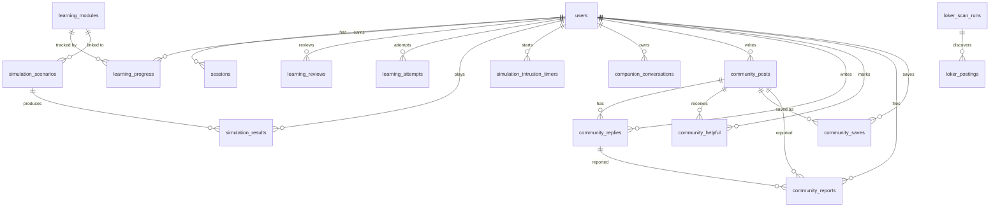

# Data Model

## 1. Principles

1. **PostgreSQL is the only durable state store** for accounts, sessions,
   content, progress, results, community, companion metadata, and jobs.
2. **The app never creates tables.** `npm run db:migrate` applies numbered SQL
   migrations before the app receives traffic.
3. **JSONB is used deliberately.** Learning module content and simulation
   payloads are documents validated by Zod, not normalized into dozens of
   tables for a competition-scoped feature.
4. **All user-facing timestamps are `timestamptz`.** The UI formats them for
   `Asia/Jakarta`.
5. **Deletes are soft where moderation or recovery matters**; expired auth
   state is hard-deleted by cleanup.
6. **Evidence quotes are not persisted** in the job corpus; only signal labels
   and weights are stored.

---

## 2. Entity relationship diagram

`oauth_states` and `auth_attempts` are standalone key/value-style tables.

---

## 3. Tables

### 3.1 `users`

Created by `001_auth.sql`.

| Column | Type | Constraints |
| --- | --- | --- |
| `id` | uuid | Primary key. |
| `email` | text | Not null, unique, `email = lower(email)`. |
| `nama` | text | Not null. Display name, 1–80 by application validation. |
| `password_hash` | text | Nullable; null for Google-only accounts. |
| `google_sub` | text | Nullable, unique; Google subject. |
| `created_at` | timestamptz | Not null. |

Application rules: emails are trimmed and lowercased; passwords are 8–128
characters and hashed with scrypt (`N=32768, r=8, p=3`, 16-byte salt,
64-byte key). A Google account with the same email as a password account is not
auto-linked; `google-link-required` is returned instead.

### 3.2 `sessions`

| Column | Type | Constraints |
| --- | --- | --- |
| `token_hash` | text | Primary key; SHA-256 of the raw cookie token. |
| `user_id` | uuid | FK `users(id)` on delete cascade. |
| `expires_at` | timestamptz | Not null. |
| `user_agent` | text | Nullable (added in `006_account_sessions.sql`). |
| `client_ip` | text | Nullable; only set when proxy-trusted. |
| `created_at` | timestamptz | Not null, default `now()`. |
| `last_seen_at` | timestamptz | Not null, default `now()`; updated at most every 5 minutes. |

Indexes: `sessions_expiry(expires_at)`, `sessions_user(user_id)`.

The raw token is 32 random bytes, base64url-encoded, 43 characters. Cookie
`lumina_session` is HttpOnly, SameSite=Lax, Secure in production, 24 hours.
Login rotates the previous session atomically; logout deletes the row.

### 3.3 `oauth_states`

| Column | Type | Notes |
| --- | --- | --- |
| `state_hash` | text PK | SHA-256 of the state value. |
| `verifier` | text | PKCE verifier. |
| `nonce` | text | OIDC nonce. |
| `intent` | text | `masuk` or `daftar`. |
| `expires_at` | timestamptz | 10 minutes. |

Consumed with `DELETE ... RETURNING`, which makes replay and concurrent
callbacks fail safely. Index on `expires_at`.

### 3.4 `auth_attempts`

| Column | Type | Notes |
| --- | --- | --- |
| `key` | text PK | SHA-256 of the bucket key, never a plaintext email/IP. |
| `count` | integer | Current count in the window. |
| `expires_at` | timestamptz | Window end. |

Upsert increments atomically; an expired row resets to 1. Index on
`expires_at`. `db:cleanup` deletes expired rows.

### 3.5 `learning_modules`

Created by `003_learning_simulation.sql`.

| Column | Type | Constraints |
| --- | --- | --- |
| `no` | integer PK | Between 1 and 99. |
| `metadata` | jsonb | Object; includes `no`, `nama`, `ciri`, `laporan`, `kerugian`, `level`, `status`, `scenarioId`. |
| `content` | jsonb | Object or null; null means "Segera" (not written). |
| `updated_at` | timestamptz | Default `now()`. |

Checks: `metadata->>'no' = no::text`; `content->>'no' = no::text` when content
exists. The `content` document includes anatomy, examples, checklist, quiz,
reporting steps, and key points.

### 3.6 `simulation_scenarios`

| Column | Type | Constraints |
| --- | --- | --- |
| `id` | text PK | Scenario id. |
| `module_no` | integer | FK `learning_modules(no)`, nullable. |
| `payload` | jsonb | Object; validated by `SimulationSchema`. |
| `updated_at` | timestamptz | Default `now()`. |

Check: `payload->'scenario'->'scenario'->>'id' = id`.

### 3.7 `learning_progress`

| Column | Type | Constraints |
| --- | --- | --- |
| `user_id` | uuid | FK `users(id)` cascade. |
| `module_no` | integer | FK `learning_modules(no)`. |
| `answers` | jsonb | Question id → option id. |
| `score` | integer | ≥ 0. |
| `total` | integer | > 0, score ≤ total. |
| `missed_patterns` | text[] | Pattern ids missed on the latest attempt. |
| `completed_at` | timestamptz | Null until a passing attempt. |
| `updated_at` | timestamptz | Default `now()`. |

Primary key `(user_id, module_no)`. Completion is sticky: `COALESCE(existing,
new)` so a later failed retry does not erase a completed module.

### 3.8 `learning_reviews`

Added by `011_learning_reviews.sql`.

| Column | Type | Constraints |
| --- | --- | --- |
| `user_id` | uuid | FK cascade. |
| `pattern_id` | text | Pattern id from `src/data/patterns.ts`. |
| `box` | integer | 0–4. |
| `due_at` | timestamptz | Next review. |
| `last_seen_at` | timestamptz | Last answer. |
| `correct` | integer | ≥ 0. |
| `wrong` | integer | ≥ 0. |

Primary key `(user_id, pattern_id)`. Index `(user_id, due_at)`. Intervals are
1, 3, 7, 14, 30 days; a wrong answer resets to box 0.

### 3.9 `learning_attempts`

| Column | Type | Constraints |
| --- | --- | --- |
| `id` | uuid PK | Default `gen_random_uuid()`. |
| `user_id` | uuid | FK cascade. |
| `module_no` | integer | FK `learning_modules(no)`. |
| `score` | integer | ≥ 0. |
| `total` | integer | > 0, score ≤ total. |
| `kind` | text | `quiz` or `review`. |
| `answers` | jsonb | Default `{}`. |
| `created_at` | timestamptz | Default `now()`. |

Index `(user_id, created_at desc)`. Attempts are append-only.

### 3.10 `simulation_results`

| Column | Type | Constraints |
| --- | --- | --- |
| `attempt_id` | uuid PK | Client-generated attempt id. |
| `user_id` | uuid | FK cascade. |
| `scenario_id` | text | FK `simulation_scenarios(id)`. |
| `mode` | text | `santai` or `tantangan`. |
| `outcome` | text | `success`, `recovery`, `compromised`, `failed`. |
| `decisions` | jsonb | Ordered steps. |
| `finished_at` | timestamptz | Default `now()`. |

Index `(user_id, finished_at desc)`. The server replays the scenario and
rejects a mismatched outcome. A duplicate `attempt_id` is accepted only if the
stored row is identical (idempotent retry).

### 3.11 `simulation_intrusion_timers`

Added by `008_simulation_intrusion_timers.sql`.

| Column | Type | Notes |
| --- | --- | --- |
| `attempt_id` | uuid PK | One timer per attempt. |
| `user_id` | uuid | FK cascade. |
| `scenario_id` | text | FK cascade. |
| `started_at` | timestamptz | Server receipt time. |

The timer lets the server verify that enough wall-clock time passed before
accepting a challenge-mode intrusion failure. The browser cannot prove active
play, but it cannot fabricate an immediate failure either. `db:cleanup` removes
timers older than one day that have no result.

### 3.12 `community_posts`

Created by `004_community.sql`, extended by `005_community_images`,
`006_community_gallery`, and `008_community_agents_verified`.

| Column | Type | Constraints |
| --- | --- | --- |
| `id` | uuid PK | |
| `author_id` | uuid | FK `users(id)` cascade. |
| `category` | text | `modus-baru`, `pertanyaan`, `pengalaman`. |
| `title` | text | 10–140 characters. |
| `body` | text | 30–6000 characters. |
| `source_url` | text | Optional http/https without credentials. |
| `created_at` | timestamptz | Default `now()`. |
| `updated_at` | timestamptz | Default `now()`. |
| `deleted_at` | timestamptz | Soft delete; body cleared. |
| `hidden_at` | timestamptz | Moderator hide. |
| `image_url` | text | Nullable; must start with `/images/community/`. |
| `image_urls` | text[] | Default `{}`; at most 8; seed/demo covers only. |
| `author_kind` | text | `member` or `agent`, default `member`. |
| `agent_id` | text | One of the eight detector ids; required iff agent. |
| `verified_at` | timestamptz | Admin review timestamp. |
| `verified_by` | uuid | FK `users(id)` on delete set null. |

Indexes: recent/category partial indexes exclude deleted and hidden rows;
`community_posts_verified` for the verified feed.

### 3.13 `community_replies`

| Column | Type | Constraints |
| --- | --- | --- |
| `id` | uuid PK | |
| `post_id` | uuid | FK cascade. |
| `author_id` | uuid | FK cascade. |
| `body` | text | 5–3000 characters. |
| `created_at`, `updated_at` | timestamptz | |
| `deleted_at`, `hidden_at` | timestamptz | Soft controls. |

Index `(post_id, created_at, id)`.

### 3.14 `community_helpful`

`(post_id, user_id)` primary key, both FKs cascade. One "Membantu" per account
per post.

### 3.15 `community_reports`

| Column | Type | Constraints |
| --- | --- | --- |
| `id` | bigint identity PK | |
| `reporter_id` | uuid | FK cascade. |
| `post_id` | uuid | FK cascade, nullable. |
| `reply_id` | uuid | FK cascade, nullable. |
| `reason` | text | `data-pribadi`, `spam`, `berbahaya`. |
| `created_at` | timestamptz | |
| `reviewed_at` | timestamptz | Moderator resolution. |

Exactly one of `post_id`/`reply_id` is non-null. Partial unique indexes prevent
duplicate reports per reporter and target.

### 3.16 `community_saves`

`(post_id, user_id)` PK, both FKs cascade, `created_at`. Index
`(user_id, created_at desc)`. Private: only the owner's "Disimpan" filter reads
it, and public counters do not include saves.

### 3.17 `companion_conversations`

Added by `009_companion_history.sql`.

| Column | Type | Constraints |
| --- | --- | --- |
| `id` | uuid PK | Client-generated conversation id. |
| `user_id` | uuid | FK cascade. |
| `title` | text | 1–140; sanitized to a public allowlist. |
| `turns` | integer | ≥ 0. |
| `risk` | text | Risk band or null. |
| `created_at`, `updated_at` | timestamptz | |
| `deleted_at` | timestamptz | |

Index `(user_id, updated_at desc, id desc)` partial on `deleted_at IS NULL`.
No message content, attachments, or transcript are stored.

### 3.18 `loker_scan_runs`

Created by `002_loker.sql`.

| Column | Type | Notes |
| --- | --- | --- |
| `id` | bigserial PK | |
| `started_at` | timestamptz | Default `now()`. |
| `finished_at` | timestamptz | Null while running. |
| `status` | text | `running`, `ok`, `failed`. |
| `found`, `added`, `dropped` | integer | Default 0. |
| `provider_errors` | jsonb | Array of `{company, error}`. |
| `exit_code` | integer | Child process exit code. |
| `triggered_by` | text | Scanner trigger source. |

### 3.19 `loker_postings`

| Column | Type | Notes |
| --- | --- | --- |
| `url_key` | text PK | Dedupe key. |
| `run_id` | bigint | FK run, set null on delete. |
| `title`, `company` | text | Not null. |
| `location` | text | Nullable. |
| `salary_min`, `salary_max` | bigint | Nullable. |
| `salary_currency` | text | Nullable. |
| `tags` | text[] | Default `{}`. |
| `description` | text | Not null, capped at 4,000 chars. |
| `apply_url` | text | Nullable. |
| `source` | text | Board name. |
| `posted_at` | date | Nullable. |
| `company_email` | text | Nullable since `005_loker_nullable_enrichment.sql`. |
| `domain_age_days` | integer | Nullable for the same reason. |
| `employer_known` | boolean | Not null. |
| `sentinel_status` | text | `clean`, `suspicious`, `rejected`. |
| `sentinel_flags` | text[] | Default `{}`. |
| `trust_score` | integer | 0–100. |
| `trust_level` | text | Trust band. |
| `lumina_score` | integer | 0–100. |
| `lumina_risk` | text | Risk band. |
| `lumina_signals` | jsonb | `{label, weight}[]` only; no evidence quotes. |
| `fetched_at` | timestamptz | Default `now()`, refreshed on upsert. |

Indexes: `posted_at desc nulls last`, `sentinel_status`, GIN on `tags`.

### 3.20 `loker_domain_cache`

| Column | Type | Notes |
| --- | --- | --- |
| `domain` | text PK | Registrable domain. |
| `age_days` | integer | Nullable. |
| `status` | text | `ok`, `unknown`, `error`. |
| `checked_at` | timestamptz | Default `now()`. |

Successful entries are fresh for 30 days; error entries for 1 hour. Concurrent
rows for the same domain share one in-flight RDAP request.

### 3.21 `schema_migrations`

| Column | Type | Notes |
| --- | --- | --- |
| `version` | text PK | The migration filename, e.g. `011_learning_reviews.sql`. |
| `applied_at` | timestamptz | Default `now()`. |

The migration advisory lock is `7368412`; content seeding uses `7368413`.

---

## 4. Migration inventory

| File | Adds |
| --- | --- |
| `001_auth.sql` | users, sessions, oauth_states, auth_attempts. |
| `002_loker.sql` | scan runs, postings, domain cache. |
| `003_learning_simulation.sql` | modules, scenarios, progress, results. |
| `004_community.sql` | posts, replies, helpful, reports; removes old Darurat copy from scenarios. |
| `005_community_images.sql` | `community_posts.image_url` with local-prefix check. |
| `005_loker_nullable_enrichment.sql` | makes email/domain age nullable. |
| `006_account_sessions.sql` | session metadata and user index. |
| `006_community_gallery.sql` | `image_urls` (max 8) and backfill. |
| `007_community_saves.sql` | private saves. |
| `008_community_agents_verified.sql` | agent authorship and admin verification. |
| `008_simulation_intrusion_timers.sql` | challenge-mode timer. |
| `009_companion_history.sql` | metadata-only conversation history. |
| `010_companion_private_titles.sql` | resets titles that copied message excerpts. |
| `011_learning_reviews.sql` | reviews and attempts. |

Numeric prefixes are **not unique** across feature branches (`005`, `006`,
`008` each appear twice). `schema_migrations.version` stores the full filename,
so all files apply independently. Do not renumber an applied migration; add a
new file.

### Migration runner semantics

`scripts/migrate.mjs`:

1. Requires `DATABASE_URL`.
2. Takes advisory lock `7368412` for the whole run.
3. Creates `schema_migrations` if absent.
4. Sorts `^\d+_[\w-]+\.sql$` filenames and skips applied ones.
5. Runs each file in a transaction; failure rolls back that file and aborts.
6. Releases the lock.

It prints nothing on success. Verify by querying `schema_migrations` and the
expected objects.

---

## 5. Seed and import pipelines

| Command | Purpose | Replace semantics |
| --- | --- | --- |
| `npm run db:migrate` | Apply DDL. | Idempotent. |
| `npm run db:seed` | Load `content/competition.json` (modules + simulations). | Default `ON CONFLICT DO NOTHING`; pass `-- <file> --replace` to update named rows. |
| `npm run db:seed:community` | Demo members/posts/replies for local presentation. | Idempotent; never on production. |
| `npm run db:seed:community:agents` | Eight agent-authored briefs. | Idempotent; never on production. |
| `npm run db:cleanup` | Delete expired sessions, OAuth state, rate counters, stale timers. | Destructive only for expired rows. |
| `npm run db:import-sqlite -- <backup>` | One-time account cutover. | Transactional; conflict aborts. |

### Content seed details

`scripts/seed-content.mjs` resolves `@/` aliases to TypeScript sources,
validates the whole bundle with `ContentBundleSchema`, locks advisory
`7368413`, and imports modules then simulations in one transaction. After
import it verifies that every `content.scenarioId` points to an existing
scenario, otherwise it rolls back.

The script reads `argv[2]` as the input path. `npm run db:seed -- --replace`
tries to open a file named `--replace`; use
`npm run db:seed -- content/competition.json --replace`.

### SQLite import

`scripts/import-sqlite.mjs` reads the old SQLite file read-only and imports
only users (UUID, email, name, password hash, Google subject). Sessions and
OAuth state are discarded. A conflict rolls back the entire import. The source
is never modified.

---

## 6. Data classification and retention

| Data | Class | Retention |
| --- | --- | --- |
| Account identity, password hash | Personal | Until account deletion (cascade). |
| Sessions, OAuth state | Secret metadata | 24 h / 10 min; cleanup. |
| Rate counters | Operational | Window; cleanup. |
| Learning progress and attempts | Personal learning record | Until account deletion. |
| Simulation results | Personal learning record | Until account deletion. |
| Community posts/replies | Public content | Soft delete; hidden stays in DB. |
| Reports | Moderator-only | Until reviewed; retained for audit. |
| Saves | Private per account | Until removed or account deletion. |
| Companion history metadata | Personal metadata | Until deleted/account deletion. |
| Checked message | Never stored server-side | N/A. |
| Job corpus | Public postings + derived labels | Refreshed on scan; cumulative. |
| Backup dumps | Contains personal data | At least 7 daily copies; protect as credentials. |

---

## 7. Query and schema rules

1. Use parameterized queries (`$1`, `$2`); never interpolate user input.
2. Import `authDatabase()` only from server code (`import "server-only"`).
3. The pool is a singleton with a maximum of five connections per process.
4. Scope every user mutation by `user_id` from the session.
5. Prefer partial indexes for "visible rows" queries.
6. JSONB documents are validated with Zod before write and after read.
7. Add a migration for every schema change; do not mutate production manually.
8. Migrations must be additive and backward-compatible so the previous image
   can run during rollback.
9. Do not store evidence quotes, message text, or transcripts.
10. After a migration, verify both `schema_migrations` and a resulting object;
    silence is not evidence.
