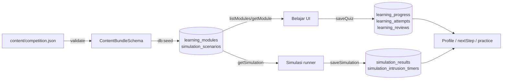

# Learning and Simulation Architecture

Belajar and Simulasi share a content store, an account model, and a server-side
grading posture. They are separate surfaces with separate state machines.

---

## 1. Learning (Belajar)

### 1.1 Content model

Content lives in PostgreSQL, not in bundled TypeScript:

| Table | Shape |
| --- | --- |
| `learning_modules` | `no`, `metadata` JSONB, `content` JSONB (nullable), `updated_at`. |
| `simulation_scenarios` | `id`, `module_no`, `payload` JSONB. |

`metadata` follows `ModuleMetadataSchema`:

```ts
{
  id, no, nama, laporan, laporanNote, kerugian,
  ciri: string[], level: 1..5, modulStatus,
  scenarioId: string | null, scenarioPlanned: string | null,
  detectors: ("message"|"link"|"identity"|"conversation")[]
}
```

`content` is a `ModuleContent` document:

- `anatomi`: 5 teaching steps.
- `contoh`: a marked example message.
- `checklist`: at least 4 red flags.
- `kuis`: questions with options, `correctId`, and per-option rationale.
- `lapor`: ordered reporting steps.
- `poin`: key points.

A module with `content = null` is shown as **Segera**. The UI derives
`modulStatus` from content presence (`src/lib/content/store.ts`), not from seed
metadata.

### 1.2 Catalogue

`src/data/modus.json` is the single source of truth for the 12 schemes. It is
validated with Zod and supplies:

- Scheme name, characteristics (`ciri`), reported loss, module number.
- `scenarioId` or `scenarioPlanned`.
- Detector ids relevant to the module.

The catalogue computes a next step from progress and available content. A
module is "ready" only when `content` is non-null and a playable scenario may
exist.

### 1.3 Progress model

`readAccountProgress()` returns `Progress`:

```ts
{
  version: 2,
  completedModules: number[],
  badges: string[],
  missedPatterns: string[],
  reviews: Review[],
  attempts: Attempt[],
  updatedAt: string
}
```

Sources:

- `learning_progress` — one row per user/module; latest answers, score, missed
  patterns, sticky `completed_at`.
- `learning_reviews` — one row per user/pattern; SRS box, due date, counts.
- `learning_attempts` — append-only quiz/review history.

`missedPatterns` is reconciled: patterns that are still due or wrong in box 0
remain; old question-id-based misses are migrated to pattern ids by
`migrateMisses()`.

### 1.4 Quiz grading

Client: `src/components/belajar/quiz.tsx` renders questions, shuffles options
deterministically per question and retry (FNV-1a seed + mulberry32), and shows
rationale.

Server: `saveQuiz()` in `src/lib/learning/store.ts`:

1. Loads the published module.
2. Requires every question answered with a valid option id.
3. Grades against `correctId` — the server does not trust the client's score.
4. Requires ≥ 60% to mark the module complete.
5. Upserts `learning_progress` and keeps completion sticky.
6. Records a `learning_attempts` row and updates SRS boxes.

A guest can read and play, but must sign in to save. There is no localStorage
fallback and no automatic import of old local progress.

### 1.5 Spaced repetition

`src/lib/learning/review.ts`:

| Box | Interval |
| --- | --- |
| 0 | 1 day |
| 1 | 3 days |
| 2 | 7 days |
| 3 | 14 days |
| 4 | 30 days |

- Correct: box + 1 (max 4).
- Wrong: box 0, added to `missedPatterns`.
- `dueAt` is computed with UTC calendar arithmetic so every device agrees.
- `dueReviews()` returns due entries sorted by due date then pattern id.

The UI labels due dates as `hari ini`, `besok`, or `N hari lagi`.

### 1.6 Adaptive next step

`nextStep()` in `src/lib/learning/path.ts` returns one of:

1. **review** — a due pattern whose module is ready.
2. **remediation** — a missed pattern in a completed module, with no review row
   yet.
3. **module** — the next uncompleted ready module, ordered by level then number.
4. **practice** — mixed practice when all ready modules are complete.
5. **done** — no ready module.

Each step carries a title, reason, href, module number, pattern ids, estimated
minutes, and an optional scenario id.

### 1.7 Mixed practice

`selectPractice()`:

- Flattens every question from every module and maps it to a pattern.
- Priority: due reviews, then missed patterns, then completed modules.
- Picks 5 questions, round-robin across modules, so a set is not five questions
  from one module.
- An optional `patternId` scopes practice to one pattern.

### 1.8 Learning routes

| Route | Behavior |
| --- | --- |
| `/belajar` | Catalogue, progress, next step. |
| `/belajar/[modul]` | Module body, quiz, completion, related simulation. |
| `/belajar/latihan` | Mixed or pattern-scoped practice. |

Module completion may unlock a ready scenario through `unlocksScenario`; the
CTA only appears when the scenario is actually playable.

### 1.9 Content authoring

`/admin` is a local workbench:

- Reads published content from the database.
- Keeps drafts in the browser.
- Exports JSON in the `ContentBundleSchema` shape.
- Publishing is a reviewed import, not a button that writes to the repo.

Import:

```bash
npm run db:seed -- content/competition.json --replace
# or a single module file:
npm run db:seed -- modul-10.json --replace
```

`--replace` updates only modules/scenarios named in the file; other rows,
accounts, and progress are untouched. The import validates the entire bundle and
scenario graph, then rolls back on any error.

---

## 2. Simulation (Simulasi)

### 2.1 Scenario model

A scenario is a typed graph (`src/lib/simulasi/types.ts`):

```ts
{
  scenario: { id, level, title, difficulty: "mudah" },
  hud: {
    panic: { start, max, fail_at, fail_message },
    intrusion: { start, max, rate_per_second, fail_message }
  },
  tools: [{ id, name, unlocked_at }],
  start: string,
  nodes: ScenarioNode[],
  scoring: { grades: [{ min, label }] }
}
```

Node types:

| Type | Fields | Behavior |
| --- | --- | --- |
| `message` | `speaker`, `text`, `next`, optional `delay_ms`, optional `attachment` | Appears after a delay. |
| `choice` | `prompt`, `choices[]` | Buttons; each choice has `verdict`, `rationale`, `panic`, `tactic`, `compromisesDevice`, `sharesOtp`, `next`. |
| `tool_task` | `tool`, `prompt`, `on_success` | Interactive tool panel; success advances. |
| `ending` | `variant`, `title`, `text`, `debrief[4]` | Final screen. |

Tools: `isolation`, `permissions`, `report`.

Ending variants: `success`, `recovery`, `compromised`.

### 2.2 Static validation

`validateScenario()` runs in the catalogue at module load and during content
import. It rejects:

- Duplicate node/tool ids.
- Missing start node.
- Edges to missing nodes.
- Unreachable nodes.
- Reachable nodes that cannot reach an ending.
- Tool tasks reachable before the tool's unlock node.
- Undeclared tools.
- Wrong choice without a rationale.
- Invalid chapter, panic, or tactic values.
- Panic/intrusion HUD values outside 0–100 or invalid fail thresholds.
- Endings without exactly four non-empty debrief lines.
- Grades not ordered by descending `min`.

A broken scenario fails at build/import time instead of producing a blank screen
mid-demo.

### 2.3 Runner

`src/app/(chat)/simulasi/[id]/Runner.tsx` is a client state machine:

- Builds a map of node id → node.
- Applies `delay_ms` with cleanup on unmount.
- Tracks panic (choices add panic; breathing subtracts 15).
- Tracks intrusion (challenge mode; increases at `rate_per_second` when the
  device is compromised and not isolated).
- Unlocks tools when their `unlocked_at` node is reached.
- Records decisions in order.
- Advances through `tool_task` on success.
- Renders the ending and debrief.
- Submits the result once when the mission ends.

Known trap: every `setTimeout` needs cleanup, or a callback fires into an
unmounted component and a scene runs twice.

### 2.4 Server-authoritative result

`saveSimulation()` in `src/lib/learning/store.ts` does not trust the submitted
outcome. It:

1. Loads the scenario from the database.
2. Replays every step from `start`, skipping message nodes.
3. Verifies each step's `nodeId` and `choiceIndex`.
4. Recomputes panic, compromise, isolation, and the final node.
5. Validates the claimed outcome against the replay.
6. Inserts a result keyed by `attempt_id`; a duplicate is accepted only if the
   stored row is identical.

This prevents a client from claiming a `success` ending it never reached.

### 2.5 Challenge-mode intrusion timer

A failed-by-intrusion result requires:

- `mode = "tantangan"`,
- a compromised device choice,
- no isolation,
- no ending reached,
- a stored `simulation_intrusion_timers` row for the same user/scenario/attempt
  whose `started_at` is old enough for the scenario's intrusion meter
  (one tick of tolerance).

The browser cannot prove active play, but it cannot fabricate an instant
failure. Cleanup removes abandoned timers after a day; timers with a result are
kept so retries stay idempotent.

### 2.6 Simulation routes

| Route | Behavior |
| --- | --- |
| `/simulasi` | Catalogue, playable scenarios, level picker. |
| `/simulasi/[id]` | Runner and mission chrome. |

Unfinished levels are marked **Rencana**, not played as if complete.

---

## 3. Data flow



---

## 4. Failure behavior

| Failure | Behavior |
| --- | --- |
| Database content unavailable | Page says content cannot be loaded; it does not fall back to hidden hardcoded content. |
| Save quiz fails | UI reports failure and offers retry. |
| Save simulation fails | UI reports failure; attempt can be retried. |
| Duplicate attempt | Accepted only if identical; otherwise rejected. |
| Invalid scenario | Caught at build/import, not at runtime. |
| Guest | Can read and play; cannot save. |
| Completed module retried and failed | Completion remains (sticky). |

---

## 5. Tests

| Suite | Pins |
| --- | --- |
| `src/lib/learning/store.test.ts` | Content read, server grading, account isolation, scenario replay, idempotent retry. |
| `src/lib/learning/path.test.ts`, `review.test.ts`, `practice.test.ts` | Next-step ordering, SRS intervals, practice selection. |
| `src/lib/simulasi/validate.test.ts` | Graph validation boundaries. |
| `src/lib/simulasi/from-module.test.ts` | Module-to-scenario linking. |
| `src/app/(chat)/simulasi/[id]/Runner.test.tsx` | Runner transitions and timers. |
| `src/components/belajar/quiz.test.tsx`, `modul-body.test.tsx` | Quiz rendering, rationale, completion. |

Integration suites require `TEST_DATABASE_URL` ending in `_test`; Jest runs them
serially because they reset the same database.

---

## 6. Known limits

1. No mid-attempt resume for quizzes or simulations.
2. Guest progress is not persisted.
3. One fully playable scenario is the shipped competition scope; other levels
   are marked planned.
4. The intrusion timer measures server receipt, not active play.
5. Content is Indonesian-only.
6. The admin workbench has no CMS role, no public write endpoint, and no
   multi-author conflict resolution.
7. `laporan`/`kerugian` are claims that render as IASC figures; each needs a
   source and period when used in copy.
