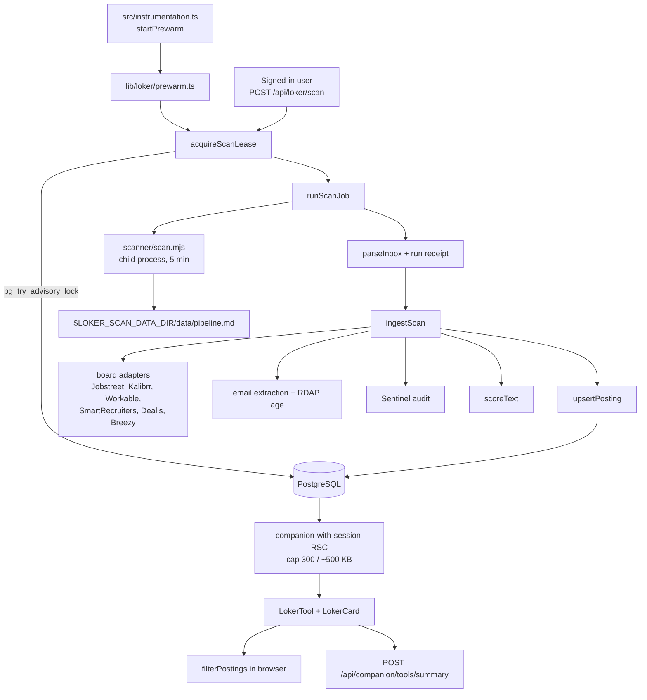

# Job Scanner Architecture

The job tool lets a signed-in reader search a cumulative corpus of real job
postings, each carrying two independent verdicts. It is a post-submission
feature built on a vendored career-ops scanner and Lumina's own scoring engine.

User-facing guide: [docs/loker-tool-guide.md](../loker-tool-guide.md).
Product/design spec: [docs/loker-tool.md](../loker-tool.md).

---

## 1. Pipeline



---

## 2. Components

### 2.1 Vendored scanner

`scanner/` is the career-ops engine, vendored byte-identical. Lumina invokes
only `scanner/scan.mjs` as a child process. It never re-implements the scan
rules.

- `scanner/.gitignore` ignores `portals.yml`, so the seed must be force-tracked
  (`git add -f scanner/portals.yml`); otherwise a fresh clone cannot bootstrap.
- The child process has a five-minute timeout and a sanitized environment.
- No shell interpolation is used.

### 2.2 Board adapters

`src/lib/loker/boards/` owns URL → board resolution and detail enrichment:

| Adapter | File |
| --- | --- |
| Jobstreet | `jobstreet.ts` |
| Kalibrr | `kalibrr.ts` |
| Workable | `workable.ts` |
| SmartRecruiters | `smartrecruiters.ts` |
| Dealls | `dealls.ts` |
| Breezy | `breezy.ts` |

Each sample URL is claimed by exactly one adapter; a test enforces
non-overlap. `pipeline.md` has no description, so the adapter fetches the
detail page. A row whose detail cannot be fetched is `dropped` and counted; it
is never inserted with an invented description.

### 2.3 Enrichment

- **Email** — extracted from description/company text.
- **Domain age** — RDAP lookup on the registrable domain of the apply URL.
  Cached in `loker_domain_cache`:
  - success: 30 days,
  - error: 1 hour,
  - concurrent rows share one in-flight promise.

Missing email or domain age is stored as `NULL`. The Sentinel audit treats null
as "not checked", never as a clean pass. This was a deliberate fix: requiring
those fields dropped every real posting (764/764 on 9 November 2026).

### 2.4 Sentinel audit

`src/lib/loker/audit/sentinel.ts` combines two signal families:

1. **Content/demand signals** — Indonesian scam rules:
   - administration fee, personal account, APK link, travel ticket, uniform,
     KTP/OTP request.
2. **Structural trust signals** — malformed URL, shortener, company↔domain
   mismatch.
3. **Identity signals** — free-mail company address, domain younger than 30
   days, unverifiable employer.

Escalation is conservative:

| Condition | Status |
| --- | --- |
| APK link, ≥ 2 content signals, invalid URL, or content + strong structural | `rejected` |
| Exactly one content or strong structural signal | `suspicious` (Careevo `quarantined`) |
| Otherwise | `clean` |

A weak structural flag never rejects a posting on its own. Missing values are
not signals.

### 2.5 Lumina verdict

The same posting text is scored by `scoreText()` with the normal detectors. The
result is stored as:

- `lumina_score`, `lumina_risk`;
- `lumina_signals` — only `{ label, weight }[]`; evidence quotes are
  deliberately not persisted.

### 2.6 Combined recommendation

`src/lib/loker/verdict.ts` applies "caution wins":

| Sentinel | Lumina risk | Recommendation |
| --- | --- | --- |
| `rejected` or `tinggi` | any | `hindari` — "Sebaiknya hindari" |
| `suspicious` or `mencurigakan` | any | `waspada` — "Periksa dulu" |
| `clean` and `bersih`/`rendah` | — | `aman` — "Aman dilamar" |

The same rule powers the "hide flagged" filter, so badge and filter cannot
disagree. The card names both verdicts when they disagree and the caution wins.

`ringkasRekomendasi()` produces counts for the tool header, the summary route,
and the offline sentence. The model may repeat the recommendation; it may not
change it.

---

## 3. Scan lifecycle

### 3.1 Admission

1. Require a session.
2. Consume `loker:scan:<client>` at 1 per 10 minutes.
3. `acquireScanLease()`:
   - takes a dedicated pool connection,
   - runs `pg_try_advisory_lock(hashtext('loker_scan'))`,
   - creates a `loker_scan_runs` row,
   - returns a lease that releases the lock exactly once.
4. If the lock is held → `409 scan-running`.
5. Schedule `runLeasedScan()` with `after()` and return `202 { runId }`.

### 3.2 Incremental window

`scanWindowDays()` asks for:

- 30 days when there is no successful run;
- otherwise days since the last successful run + 1 day of overlap,
  bounded to 1–30.

A running or failed run does not shrink the next window.

### 3.3 Ingest

`runScanJob()`:

1. Runs the scanner.
2. Reads `pipeline.md`.
3. Selects:
   - new rows from this run's receipt,
   - up to 200 newest unimported backlog rows.
4. Skips URLs already in `loker_postings`; a re-scan upserts and refreshes
   `fetched_at` instead of duplicating.
5. Ingest with concurrency 4:
   - detail fetch,
   - email extraction,
   - RDAP age,
   - Sentinel audit,
   - `scoreText()`,
   - salary parsing,
   - upsert.
6. Writes the run row (`ok`/`failed`, found/added/dropped, exit code,
   provider errors).

`runScanJob()` never throws: every failure becomes a `failed` run row, because
the UI polls that row and a silent rejection would leave it `running` forever.

### 3.4 Prewarm

`src/instrumentation.ts` starts `startPrewarm()` on the Node runtime:

- one scan shortly after boot,
- then every `LOKER_PREWARM_INTERVAL_MS` (default 6 hours),
- a failed run retries after 30 minutes,
- `0` disables the scheduler without disabling the manual button,
- the same advisory lock makes prewarm and manual scans mutually exclusive.

This is why the card can open with rows instead of a cold "belum dipindai"
state. On a brand-new database, the first minutes still show the cold state
until the first crawl commits rows.

### 3.5 Status and refresh

`GET /api/loker/scan/status` is public and returns the latest run plus
`postings`, the live corpus count. The card polls every three seconds and calls
`router.refresh()` when the corpus grows (throttled to one refresh per eight
seconds because the payload is up to ~500 KB). Rows appear while ingest is
still writing.

---

## 4. Data model

| Table | Purpose |
| --- | --- |
| `loker_scan_runs` | One row per scan; status, counts, provider errors, exit code. |
| `loker_postings` | Cumulative corpus; `url_key` dedupe; both verdicts. |
| `loker_domain_cache` | RDAP cache by registrable domain. |

Details and columns: [data-model.md](data-model.md).

Corpus limits:

- RSC loads at most 300 postings or ~500 KB, whichever comes first.
- The card prints the real count and the total when the cap applies.
- Filtering (query, location, salary, hide flagged) runs in the browser against
  that snapshot.

---

## 5. Privacy boundaries

| Data | Leaves device? | Notes |
| --- | --- | --- |
| Job search query | No | Typed by the reader or derived by the model from the reader's own question; filtered in the browser. |
| Posting title/company/verdicts | Yes, to summary route | Up to 20 rows; no query, description, apply URL, or saved list. |
| Posting description | No | Stored server-side, displayed to the reader. |
| Apply URL | To RDAP only | Public domain for age lookup. |
| Saved postings | No | `localStorage`. |
| Checked message | Never | The job tool is separate from message scoring. |

The model never scores postings and never adds findings.

---

## 6. Routes

| Route | Auth | Limit | Purpose |
| --- | --- | --- | --- |
| `POST /api/loker/scan` | session | 1 / 10 min per client key | Start a background scan. |
| `GET /api/loker/scan/status` | none | — | Latest run + live corpus size; `204` before any run. |
| `POST /api/companion/tools/summary` | none | AI limit | One-sentence summary from titles/companies/verdicts. |
| `GET /api/health` | none | — | Database only; does not check the scanner. |

---

## 7. Operations

1. First deploy: `npm run db:migrate`, then start the app.
2. Ensure `LOKER_SCAN_DATA_DIR` is writable by the app user. In the container
   it is `/app/.scan-data`, created and owned by UID 1001.
3. A scan runs in the background; do not block a request on it.
4. If a board adapter or RDAP fails, the run reports an honest drop count.
5. A high drop rate is a signal to revisit enrichment assumptions, not to insert
   partial rows.
6. `LOKER_PREWARM_INTERVAL_MS=0` on shared/CI environments that must not crawl.
7. The manual "Pindai ulang" button still works when prewarm is disabled.

---

## 8. Failure modes and limits

| Failure | Behavior |
| --- | --- |
| Scanner subprocess fails | Run row `failed`, exit code stored; old corpus remains searchable. |
| Board detail missing | Row dropped and counted; no invented description. |
| RDAP fails | Domain age null; audit treats as "not checked"; cached error for 1 h. |
| No successful run | Next scan asks for 30 days. |
| Corpus cap reached | Card prints real count and total. |
| Model summary unavailable | Deterministic sentence with counts. |
| Two verdicts disagree | Card names both; caution wins. |
| Scan already running | `409 scan-running`, never two crawls. |
| Same client retries too soon | `429 rate-limited` before the lock. |

Known limits:

- A scan can take minutes and is serialized.
- "Aman dilamar" means both engines found no scam signal in the posting and the
  audit fields they saw. It is not a guarantee: a phone call, chat, or
  post-application offer is invisible.
- The corpus is not a live search index; it is a cumulative snapshot.
- The Docker scanner path still requires a first in-container end-to-end run.
- Incremental windows trust `fetched_at` and the run table; restoring an old dump
  can require a full-month rescan.

---

## 9. Tests

| Suite | Pins |
| --- | --- |
| `src/lib/loker/boards/*.test.ts` | URL ownership, detail parsing, no overlap. |
| `src/lib/loker/audit/*.test.ts` | Fee rules, trust escalation, labels. |
| `src/lib/loker/ingest.test.ts` | Dropped rows, null enrichment, signal storage. |
| `src/lib/loker/run.test.ts` | Window calculation, receipt/backlog selection, failure row. |
| `src/lib/loker/scan.test.ts`, `start.test.ts` | Child process, advisory lease. |
| `src/lib/loker/verdict.test.ts` | Caution-wins rule, reasons, counts. |
| `src/lib/loker/store.test.ts` | Upsert, corpus order, domain cache. |
| `src/app/api/loker/**/*.test.ts` | Auth, rate limit, 409/202, status 204. |
| `src/components/companion/loker-*.test.tsx` | Card rendering, filtering, saved state. |

```bash
npm test -- src/lib/loker src/app/api/loker src/components/companion/loker
npm run verify
```
