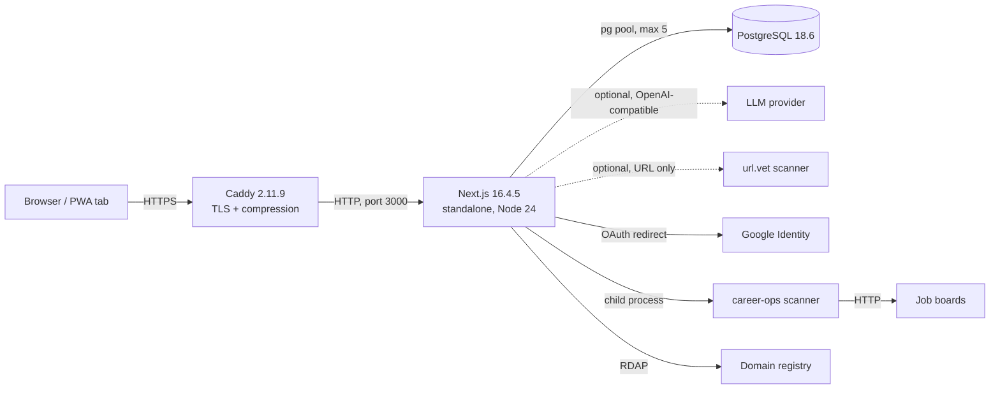
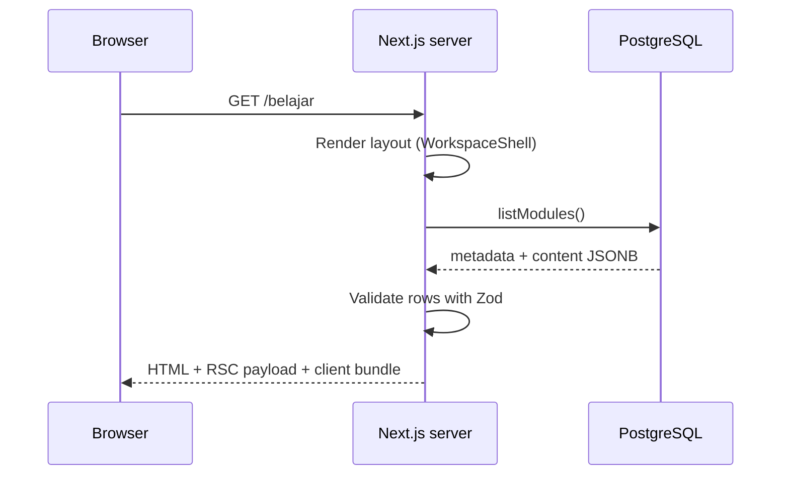
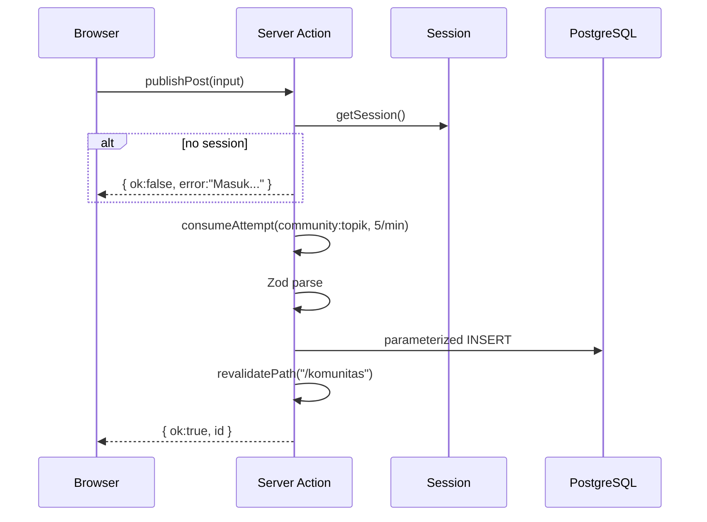
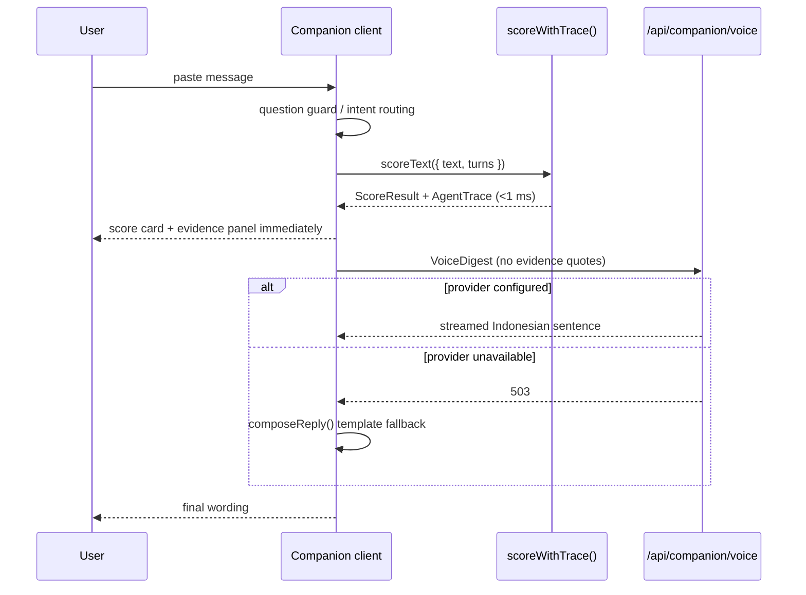
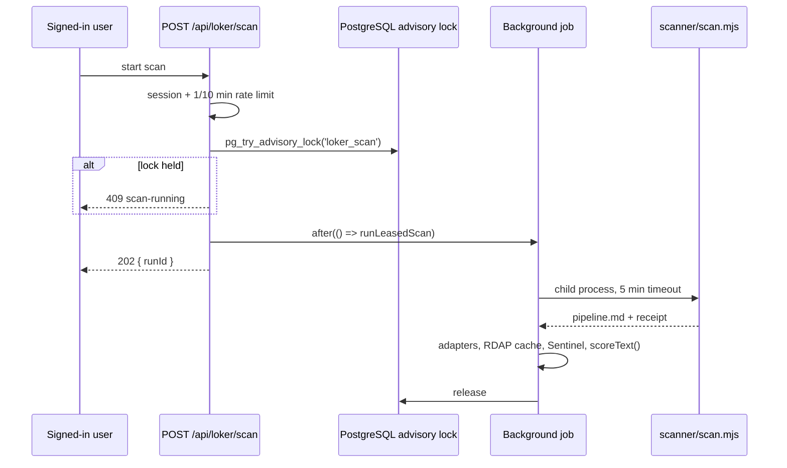

# System Overview

## 1. What Lumina is

Lumina is a scam-awareness product for Indonesian users. It combines four
surfaces into one learning loop:

| Surface | Route | Job |
| --- | --- | --- |
| **Companion** | `/companion` | Check a suspicious message; explain findings; open related learning, simulation, or report template. |
| **Belajar** | `/belajar` | Teach the pattern behind a scam through modules, quizzes, and spaced review. |
| **Simulasi** | `/simulasi` | Let the user practice a decision under pressure in a branching scenario. |
| **Komunitas** | `/komunitas` | Read and write public discussions; report content to moderators. |

Accounts, learning progress, simulation results, community content, companion
history metadata, and the job corpus live in PostgreSQL. The checked message
itself never leaves the browser.

The product is deliberately not a generic chatbot. Companion is an orchestrator
over a deterministic detection engine. The language model writes sentences; it
does not decide whether something is a scam.

---

## 2. Architecture principles

### 2.1 Deterministic verdict, probabilistic language

`src/lib/scoring/score.ts` is the only place a score is produced. It runs
synchronously in the browser, typically in under a millisecond, and its output
is a `ScoreResult`:

```ts
interface ScoreResult {
  score: number;               // 0..100
  risk: Risk;                  // derived from score
  signals: Signal[];           // never empty; sorted by weight
  modus: string;               // scheme id, or "tidak-dikenali"
  advice: string[];            // 1..4 imperative steps
  relatedModule: number | null;
  hardOverride: boolean;
}
```

The model may choose tone and structure, but it cannot move the verdict. This
matters for three reasons:

1. **Demo reliability.** A model timeout cannot turn an OTP request into
   "looks safe".
2. **Auditability.** Every finding has a rule id, a weight, and an evidence
   quote from the input.
3. **Testability.** Accuracy claims come from a fixed corpus and `runEval()`,
   not from sampling a model.

### 2.2 Privacy by schema

The privacy promise is enforced by request schemas, not by prompt text. Every
outbound AI payload uses Zod `.strict()` and has no field that can carry the
checked message:

| Route | Payload | What cannot be sent |
| --- | --- | --- |
| `/api/companion/voice` | `VoiceDigest` (risk, score, finding labels, advice) | `Signal.evidence` has no field; extra keys rejected. |
| `/api/companion/answer` | user question, chat history, lossy digest, public module/tactic facts | checked message, evidence quotes. |
| `/api/companion/vision` | image bytes | no score/risk/signal response fields. |
| `/api/companion/tools/report` | report draft fields, scheme name, tactic names | checked message, quotes, score. |
| `/api/companion/tools/summary` | posting titles, companies, verdict labels, count | query, description, apply URL, saved list. |

Full data-flow table: [security-privacy.md](security-privacy.md).

### 2.3 Honest UI

The trace contract exists so the interface cannot invent work. Agent stages
carry measured `ms`, real `findings`, and an explicit `note` when skipped. A
detector that found nothing and explained why is `dilewati`, not a green
checkmark. The Evidence Agent never says "0 findings" because it does not
detect patterns.

### 2.4 Vertical slices, shared contracts

The codebase was built by four parallel streams, one per product surface. They
share:

- `src/lib/contracts/` — frozen types (`score`, `evidence`, `answer`,
  `vision`, `agent-run`, `tool`, `report`).
- `src/lib/auth/` and `src/lib/server/` — identity and request utilities.
- `src/components/ui/`, `brand/`, `shell/` — design system.
- `migrations/` — schema.

Ownership boundaries are recorded in [AGENTS.md](../../AGENTS.md). Changes to a
shared contract must be additive and announced.

### 2.5 Database as shared state, migrations as the only DDL

The app does not create tables at runtime. `npm run db:migrate` applies numbered
SQL files and records each filename in `schema_migrations`. Content, accounts,
progress, community, and job rows all use the same PostgreSQL instance and the
same `pg` pool (maximum five connections per process).

### 2.6 Degrade without lying

Every optional dependency has an honest offline path:

| Dependency | If unavailable |
| --- | --- |
| LLM provider | Companion falls back to deterministic templates; verdict unchanged. |
| url.vet | Link verification returns `not-configured`; offline Link Agent still works. |
| Job scanner | Card shows the last corpus and an honest `belum dipindai` state. |
| PostgreSQL | Detection still works; accounts, learning, community, and job data do not. `/api/health` returns 503. |

---

## 3. System context



### External dependencies

| Dependency | Required? | Purpose | Failure behavior |
| --- | --- | --- | --- |
| PostgreSQL | Yes | Accounts, sessions, content, progress, results, community, jobs, rate counters. | Auth, learning, community, job card unavailable; local detection still works. |
| LLM provider | No | Voice, conversational answers, vision transcription, report polish, job summary. | Template fallback or 503; scores unchanged. |
| Google OAuth | No | Sign-in with Google. | Email/password still works. |
| url.vet | No | On-demand link crawl. | Route returns 503; Link Agent still works offline. |
| Job boards / RDAP | No | Job corpus enrichment. | Rows dropped or fields null; never invented. |

---

## 4. Runtime topology

### 4.1 Production (Docker Compose)

```
                    Internet
                       │ 80/443
                 ┌─────▼─────┐
                 │   Caddy   │  edge network
                 └─────┬─────┘
                       │ app_proxy (internal)
                 ┌─────▼─────┐
                 │  Next app │  UID 1001, port 3000, not published
                 └──┬─────┬──┘
        backend     │     │     egress
      (internal)    │     │    (outbound)
              ┌─────▼─┐   ▼
              │  DB   │  LLM / Google / boards / RDAP
              │ PG 18 │
              └───────┘
```

- `proxy` publishes only 80/443 (and UDP 443 for HTTP/3).
- `app` is reachable only from `proxy`; it has egress for Google, AI, and the
  scanner.
- `db` is reachable only from `app`; Caddy cannot reach it.
- PostgreSQL and Caddy data live in named volumes.
- All services log JSON with a 10 MB × 5 rotation cap.

Files: `compose.yaml`, `deploy/Caddyfile`, `Dockerfile`, `deploy/db-init/`.

### 4.2 Native deployment (current live VPS)

The live site (`https://luminaaa.web.id`) runs the app as a systemd service
from `/opt/lumina` with `next start -H 127.0.0.1 -p 3000`, `EnvironmentFile`
`.env.local`, and nginx terminating TLS. The Docker path remains the documented
portable deployment; operational details are in [operations.md](operations.md).

### 4.3 Build shape

`next.config.ts` sets:

```ts
output: "standalone"
cacheComponents: true
partialPrefetching: true
```

The Dockerfile builds with Node `24.22.2-bookworm-slim`, copies
`.next/standalone`, static assets, `public/`, content, scripts, migrations, and
the vendored scanner, then runs as non-root UID 1001.

---

## 5. Logical layers

```
src/app/            routes, layouts, route handlers, Server Actions entrypoints
src/components/     product UI by domain (companion, belajar, simulasi, community, ...)
src/lib/            domain logic (scoring, auth, learning, community, loker, ...)
src/data/           static datasets and schemas (modus, patterns, tactics, modules)
src/styles/         token layers (appnext, landing, powder)
content/            seed content bundle (modules + simulations)
migrations/         numbered PostgreSQL DDL
scripts/            migrate, seed, cleanup, SQLite import, WIP report
scanner/            vendored career-ops engine (do not edit)
deploy/             Caddyfile, backup script, DB init hook
docs/               product, feature, and architecture documentation
```

### Dependency direction

```
app → components → lib → contracts/data
app → lib → PostgreSQL / external services
components → contracts (types only)
lib/scoring → data, contracts (no network, no DB)
```

`src/lib/scoring/` is pure: no `server-only`, no `fetch`, no database. That is
why the browser can run the verdict and why the benchmark is deterministic.

---

## 6. Request lifecycles

### 6.1 Server-rendered page



Dynamic pages set `export const instant = false` where required. Session reads
in layouts are wrapped in `Suspense` (`NavWithSession`) so a cookie read does
not make every route dynamic.

### 6.2 Server Action mutation



Identity always comes from the session, never from the request body.

### 6.3 Companion check (local verdict + optional voice)



The verdict is visible before the network call finishes. A slow model cannot
delay the score.

### 6.4 Job scan



A boot-time scheduler uses the same lease, so prewarm and a user trigger can
never crawl concurrently.

---

## 7. Trust boundaries

| Boundary | Trusted side | Untrusted side | Control |
| --- | --- | --- | --- |
| Browser ↔ app | Server session cookie | All request bodies | HttpOnly cookie, Zod, ownership checks. |
| App ↔ database | App role `lumina_app` | Public internet | Internal network, no public port, least privilege. |
| App ↔ LLM | Server-held key | Model output | Strict outbound schema, bounded deadline, output treated as text only. |
| App ↔ url.vet | Server-side URL | Third-party scanner | Only URL sent, per-link opt-in, result never feeds score. |
| Proxy ↔ app | Caddy-observed IP | Client-supplied headers | `TRUST_PROXY` + `X-Lumina-Client-IP` only. |
| Checked message | User's device | — | Never serialized into any outbound schema. |

Detailed threat model: [security-privacy.md](security-privacy.md).

---

## 8. Quality gates

```
npm run verify = typecheck + Biome lint + Jest + production build
```

Additional evidence:

- `src/lib/scoring/eval.ts` measures the benchmark corpus.
- PostgreSQL integration suites run when `TEST_DATABASE_URL` points at a
  throwaway database whose name ends in `_test`.
- `scripts/verify-lumina.sh` (project skill) checks git, build age, service,
  migrations, content counts, and live pages in one pass.

See [testing.md](testing.md).

---

## 9. Known architectural limits

1. **Detection is rule-based and Indonesian-first.** It is not a general ML
   classifier. Eleven of sixty benchmark scams stop at `mencurigakan` rather
   than `tinggi`.
2. **The checked message cannot be verified against external threat feeds
   automatically.** Link and file verification are opt-in and do not change the
   score.
3. **Voice is best-effort.** A provider timeout falls back to templates.
4. **Companion history stores metadata only.** The transcript is not
   recoverable on another device.
5. **The job scanner is a child process with an external engine.** It can be
   slow and its board adapters can break when a site changes.
6. **The community feature is competition-scoped.** No DMs, realtime, email
   notifications, user image uploads, karma, or large-scale CMS.
7. **Password reset and email verification are not implemented.**
8. **The Docker Compose path and real Google OAuth still require
   environment-specific verification** beyond the dated local evidence.
