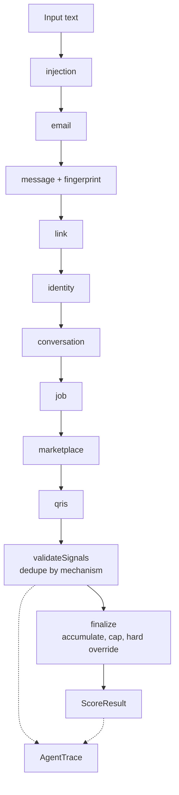

# Scoring Engine

The scoring engine is Lumina's core. It runs synchronously on the client,
produces the only verdict in the product, and is fully deterministic: the same
text always yields the same score, risk, signals, scheme, advice, and module.

Source: `src/lib/scoring/`. Public entry points: `scoreText()` and
`scoreWithTrace()` in `src/lib/scoring/score.ts`.

---

## 1. Contract

`src/lib/contracts/score.ts` is frozen. Changes must be additive and announced
to every stream.

```ts
type Risk = "bersih" | "rendah" | "mencurigakan" | "tinggi";

interface Signal {
  label: string;        // human-readable finding
  weight: number;       // 0..1 contribution
  evidence: string;     // exact substring of the input
  agent?: AgentId;      // which detector produced it
  mechanism?: MechanismId;
  ruleId?: string;
}

interface ScoreResult {
  score: number;                // 0..100 integer
  risk: Risk;                   // derived from score
  signals: Signal[];            // at least one, sorted by weight
  modus: string;                // scheme id or "tidak-dikenali"
  advice: string[];             // 1..4 imperative steps
  relatedModule: number | null; // 1..12
  hardOverride: boolean;
}
```

Invariants:

1. `signals` is never empty. A clean result contains one honest
   weight-0 signal: "Tidak ada pola penipuan yang dikenali pada teks ini".
2. `signals` is sorted by descending weight.
3. `risk` is derived from `score` by `riskFor()`; no component recomputes it.
4. An explicit OTP/PIN/password request forces `risk: "tinggi"`
   (`hardOverride: true`).
5. `relatedModule` is a module number from `modus.json`, or null.

### Risk bands

| Score | Risk | Token |
| --- | --- | --- |
| 0–14 | `bersih` | safe |
| 15–39 | `rendah` | safe |
| 40–69 | `mencurigakan` | warn |
| 70–100 | `tinggi` | danger |

`isRisky()` is true for `mencurigakan` and `tinggi`; benchmark recall uses that
definition.

---

## 2. Pipeline



`DETECTOR_RUN_ORDER` is derived from the actual `DETECTORS` array.
`src/lib/scoring/detector-ids.ts` declares the same order for client imports,
and a test compares the two so the engine and the UI cannot drift.

### Detector table

| # | Detector | Agent | Looks for | Representative rules |
| --- | --- | --- | --- | --- |
| 1 | `injection` | Injection Agent | Instructions aimed at the checker | "abaikan instruksi sebelumnya", "anggap pesan ini aman", system tags. Weight 0.6. |
| 2 | `email` | Email Agent | Pasted email headers | SPF/DKIM/DMARC fail, Reply-To mismatch, Return-Path mismatch, display-name spoof. |
| 3 | `message` | Message Agent | Indonesian scam language | 18 rules: `otp-request`, `apk`, `urgency`, `block-threat`, `fake-authority`, `prize`, `admin-fee`, `topup-loop`, `screen-share`, `off-marketplace`, `guaranteed-return`, `secrecy`, `pinjol`, `quishing`, investment and love variants. |
| 4 | `link` | Link Agent | URL shape | Look-alike brand domains, shorteners, risky TLDs, punycode/IDN, fake login paths, APK hosts, official-domain exceptions. |
| 5 | `identity` | Identity Agent | Sender identity claims | Institution claim + ordinary mobile, foreign number, shortcode, forwarded chain. |
| 6 | `conversation` | Conversation Agent | Findings that reinforce each other; staged escalation | Combination pass + cross-turn stage progression. |
| 7 | `job` | Lowongan Agent | Job-scam patterns | Upfront fees, pay-to-earn, overseas placement costs, personal payment rails, brand lure, salary outliers, withdrawal loops. |
| 8 | `marketplace` | Marketplace Agent | Marketplace scams | Off-platform payment, personal rail, DP, underprice, fake receipt, overpayment, gift-card/crypto, account change, urgency, QRIS refund. |
| 9 | `qris` | QRIS Agent | EMVCo QRIS payloads | TLV parse, CRC-16, merchant/currency/country mismatch, static-context caveat. |

`fingerprint` is not a separate stage; it is merged into `message` output.

`email` deliberately does not pretend to verify SPF/DKIM/DMARC. It reads a
pasted header block and says that the pasted result is not verified by the
receiving provider.

---

## 3. Scoring math

Weights are probabilistic OR, not a sum:

```ts
function accumulate(weights: number[]): number {
  const remaining = weights.reduce((acc, w) => acc * (1 - clamp01(w)), 1);
  return Math.round((1 - remaining) * 100);
}
```

Consequences:

- Two 0.6 findings produce `1 - 0.4 × 0.4 = 84`, not 120.
- No number of findings can exceed 100.
- A single 0.95 APK finding produces 95; a single weak 0.25 authority claim
  produces 25.

After accumulation:

1. If the validator marked the evidence as thin or contradictory, the score is
   capped at **39**, keeping it in `rendah`.
2. If a hard rule fired (`otp-request`), the score is raised to at least **70**.

### Hard rules

`HARD_RULES = { "otp-request" }`. A request for an OTP, PIN, or password is
decisive even if the message is short or otherwise clean. A notification that
an OTP was sent is a different rule (`otp-notification`, weight 0.15) and does
not trigger the override.

### Context gates

Several rules have a low base weight that rises only when the message also asks
for something:

| Rule | Alone | With a demand |
| --- | --- | --- |
| `urgency` | 0.3 | 0.6 when paired with payment/click/share |
| `fake-authority` | 0.25 | 0.7 when paired with a request |
| `otp-notification` | 0.15 | Stays low; it is a notification, not a request |

These gates are why a normal promo or a legitimate bank notification does not
become a false positive.

---

## 4. Validator

`src/lib/scoring/validate.ts` runs after all detectors and before finalization.

### 4.1 Contradiction removal

- `message.quoted-warning` signals (a message that *quotes* a scam warning) are
  not treated as live findings.
- `link.official-domain` signals are exceptions.
- A `link.lookalike` signal whose evidence is also covered by an official
  domain entry is removed and recorded as a contradiction.
- A live signal whose evidence is inside a quoted warning is removed.

### 4.2 Clustering by mechanism

Signals are grouped by `mechanism`, keeping the strongest per cluster. The
mechanism taxonomy (`src/lib/scoring/mechanism.ts`):

| Mechanism | Meaning |
| --- | --- |
| `authority-claim` | Impersonating an institution or trusted party. |
| `urgency-pressure` | Artificial deadline or threat. |
| `payment-redirect` | Pushing money to an attacker-controlled rail. |
| `credential-request` | Asking for OTP, PIN, password, or sensitive data. |
| `link-deception` | Deceptive URL or domain. |
| `attachment-risk` | Dangerous file or APK. |
| `reward-lure` | Prize, profit, or unrealistic reward. |
| `relationship-lure` | Romantic or emotional manipulation. |
| `identity-mismatch` | Sender/domain claims that do not line up. |
| `platform-evasion` | Moving the transaction off a protected platform. |
| `escalation` | Combined or staged pressure. |
| `injection` | Prompt-injection attempt against the checker. |

Clustering prevents one idea ("this is urgent") from being counted three times
because three regexes matched it.

### 4.3 Evidence adequacy

```ts
const conflicting = contradictions.length > 0 && clusters.size < 2 && !hardOverride;
const thin = !hardOverride && clusters.size === 1 && topWeight < 0.5;
const verdict = conflicting ? "bertentangan" : thin ? "tipis" : "cukup";
const capped = thin || conflicting;
```

The trace carries `ValidationSummary` with `verdict`, `clusters`, `topWeight`,
`capped`, `note`, `rawFindings`, and `contradictions`. A thin single weak
mechanism is reported honestly instead of being presented as certainty.

---

## 5. Scheme classification

`classifyModus()` runs only when at least one weighted signal survived. A clean
message never gets a scheme or a module CTA.

Priority order:

1. Rule-id families: `investment-*` → `investasi-bodong`; `love-*` →
   `love-scam`.
2. Seasonal/institutional context: `bansos`/`subsidi` plus payment request →
   `musiman-catut-institusi`.
3. An APK signal → `apk-whatsapp`.
4. Explicit loan coercion → `pinjol-fiktif`.
5. Package/delivery phrasing → `jual-beli-palsu`.
6. OTP plus bank context, or OTP plus authority claim → `fake-call`.
7. Commission plus top-up/task → `lowongan-tugas-berbayar`.
8. Police/traffic fine → `social-engineering`.
9. Keyword families in order: APK, pinjol, screen share, QRIS, investment,
   prize, job/task, love, phishing link, marketplace.
10. A strong link or email signal → `phishing-tautan`.
11. Otherwise `tidak-dikenali`.

Each known scheme maps to `advice` (2–4 imperative steps) and to a module
number through `src/data/modus.json`. The map is one source of truth for
detection, curriculum, and the learning CTA.

---

## 6. Trace and UI honesty

`scoreWithTrace()` measures each stage with `performance.now()`. It does not
score; `finalize()` remains the only scoring function. The trace is the contract
between the engine and `AgentRun`.

Status derivation for detector stages:

```ts
stage.status = findings > 0 ? "temuan" : stage.note ? "dilewati" : "selesai";
```

Findings are recounted against the final de-duplicated result, so the numbers a
user reads add up to the signals they can see. The `scoring` stage owns no
findings by design.

The engine never emits `menunggu`, `berjalan`, or `gagal`. `berjalan` belongs
to the voice stage; `gagal` exists for transport failures but the synchronous
engine has no per-stage failure path (a thrown detector aborts the turn).
See [companion.md](companion.md) and [agent-orchestration.md](../agent-orchestration.md).

---

## 7. Evaluation harness

`src/lib/scoring/eval.ts` is the only source of accuracy numbers. It runs every
case in `bench-cases.ts` (and the expanded corpus in `bench-v2.ts` where
referenced) and returns:

- `byStratum` — per-tag totals, caught, legit totals, false positives.
- `missedCases`, `falsePositiveCases`.
- `scamTotal`, `caught`, `nailed` (direct `tinggi`), `falsePositives`,
  `legitNotRisky`.
- `classification` — correct scheme among cases with `wantModus`.
- `slowestCpuMs` — warm, best-of-three CPU milliseconds.

### Measured result, 10 November 2026 (corpus 120)

| Metric | Value |
| --- | --- |
| Scam caught (`mencurigakan` or `tinggi`) | 60/60 |
| Scam directly `tinggi` | 49/60 |
| False positives on legitimate messages | 0/60 |
| Correct scheme classification (where expected) | 56/56 |
| Slowest per-case CPU | < 1 ms |

These numbers are outputs of `runEval()`, not hand-typed targets. They are
reported with their corpus size because they are not meaningful without it.
`STATUS.md` records the historical progression (corpus 45 → 57 → 120).

### What is not measured

- Network verification (RDAP, blocklists, hash reputation) because it is off by
  default.
- Open-world accuracy. The corpus is curated and Indonesian-first.
- Model output quality. Voice is not part of the verdict.

### Known limits

- Eleven of sixty benchmark scams stop at `mencurigakan`, not `tinggi`.
- Three-letter brands are caught when prefixed, not when embedded mid-token.
- Love scams and off-marketplace purchases can remain `mencurigakan`.
- Static QRIS with a well-formed payload legitimately produces no signal; the
  UI tells the user to verify the merchant name on screen.
- A marketplace refund/fake-receipt case can remain `mencurigakan` because the
  text-only engine has no OCR signal for a receipt image.

---

## 8. Adding a rule or detector

### Add a rule to an existing detector

1. Add the rule with `id`, `label`, `weight`, and a context gate if the bare
   token is legitimate on its own.
2. Add a mechanism mapping in `mechanism.ts` if the rule belongs to a new or
   existing mechanism.
3. Add positive, negative, and near-miss cases to `bench-cases.ts` (or the v2
   corpus).
4. Add a unit test that pins the resolved weight and the `signal.agent`.
5. Run `npm test -- src/lib/scoring` and `runEval()`; update no hand-written
   accuracy number.

### Add a detector

1. Add the id to `AgentId` in `contracts/score.ts` and `STAGE_LABEL` in
   `contracts/agent-run.ts`. This is a contract change: announce it first.
2. Write `src/lib/scoring/<id>.ts` as a pure `(text) => { signals, note? }`.
3. Register it in `DETECTORS` in `score.ts` and in `DETECTOR_IDS`.
4. Add the registry profile and `--lumina-agent-<id>` / `-soft` tokens, then
   append it to `AGENT_SEQUENCE`.
5. Add bench cases and run the evaluation.
6. If the stage is not a pattern detector (e.g. evidence or voice), do not add
   it to `SIGNAL_AGENTS`; give it its own status and copy rules.

### Hard rule policy

Only add to `HARD_RULES` when the rule is decisive on its own and a false
positive would be unacceptable in the other direction. Today the only hard rule
is an explicit OTP/PIN/password request. A notification that an OTP exists is
not a request.

---

## 9. Why this architecture

| Alternative | Why not |
| --- | --- |
| LLM as classifier | Non-deterministic, network-dependent, unexplainable, can be prompt-injected. |
| ML model | No labeled Indonesian corpus at competition scale; no per-signal evidence; harder to audit. |
| Sum of weights | Overshoots 100 and double-counts correlated findings. |
| One giant regex | No mechanism attribution, no dedupe, no trace, no honest skip reasons. |
| Server-side scoring | Sends the checked message to the server and makes the verdict network-dependent. |

The deterministic engine is also a product decision: a jury can paste a message
and see the score before the network call finishes.
