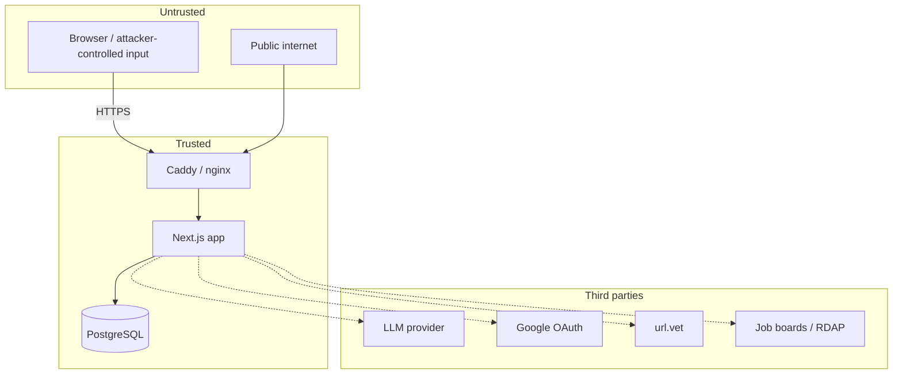

# Security and Privacy

This document states the threat model, the controls that exist, and the gaps
that remain. It is written to be verifiable against the code, not aspirational.

---

## 1. Assets and classifications

| Asset | Classification | Where it lives |
| --- | --- | --- |
| Checked message | Sensitive user content | Browser memory only. Never persisted or sent. |
| Account identity, email | Personal data | `users`. |
| Password hash | Credential | `users.password_hash` (scrypt). |
| Session token | Secret | Browser cookie + SHA-256 in `sessions`. |
| OAuth state/verifier/nonce | Secret, short-lived | `oauth_states`, 10 minutes. |
| Learning progress/results | Personal learning record | PostgreSQL, scoped by user. |
| Community posts | Public content | PostgreSQL; public read. |
| Reports/saves | Restricted/private | PostgreSQL; moderator/owner only. |
| Companion history metadata | Personal metadata | PostgreSQL; no transcript. |
| Job corpus | Public data + derived labels | PostgreSQL. |
| Provider credentials | Secret | Environment, server only. |
| Database backups | Contains personal data | Off-app storage; protect as credentials. |

---

## 2. Threat model

### 2.1 Boundaries

### 2.2 Threats and controls

| Threat | Control | Residual risk |
| --- | --- | --- |
| Credential stuffing / brute force | 10 login attempts per email per 15 min, global counters, scrypt with timing-safe compare. | Distributed attacks across many emails; no CAPTCHA. |
| Account enumeration | Generic login error; registration error does not confirm existence. | Timing differences are possible but scrypt dominates. |
| Session theft | HttpOnly, SameSite=Lax, Secure in production, 24 h expiry, hashed token, rotation on login, revocation. | XSS could still act as the user; no CSP is configured in `next.config.ts`. |
| CSRF | SameSite=Lax cookies; Next Server Actions enforce origin checks. | Cross-site top-level GETs are allowed by design; state changes are POST actions. |
| OAuth CSRF/replay | State bound to cookie, timing-safe compare, atomic delete, PKCE S256, nonce, ID-token signature/issuer/audience/expiry. | Provider compromise. |
| Account takeover via Google email collision | Same email is not auto-linked; `google-link-required`. | User cannot merge accounts yet. |
| Privilege escalation to moderator | UUID allowlist checked server-side on every action; no browser input or registration path. | Allowlist misconfiguration. |
| IDOR on community/learning | Every mutation scopes by session `user_id`; ownership checked. | A future query missing the scope. Enforce in review. |
| Message exfiltration to model | Strict outbound schemas with no message/evidence field; voice digest drops `evidence`. | A future schema change could add a field. Tests and review must catch it. |
| Prompt injection in checked message | The message is not sent to the model; injection is itself a detector. | Model output could still be influenced by user questions, but it cannot change the score. |
| Malicious file upload | No community uploads; vision accepts images only and returns text; no file storage. | Image parser/provider risk is delegated to the provider. |
| SSRF via link verification | Only an http/https URL is sent to a separate scanner; the app does not fetch the URL itself. `/api/verify-link` performs bounded public lookups with a URL guard. | Scanner-side SSRF risk is the scanner's responsibility. |
| Oversized bodies / memory exhaustion | Streaming body caps (512 B to 8.1 MB) and early cancel. | Many concurrent requests; rate limits and infra limits. |
| Rate-limit bypass | Proxy-trusted IP only; `X-Forwarded-For` ignored; anonymous users share a bucket. | All anonymous users behind a misconfigured proxy share one bucket. |
| Database exposure | DB on internal Docker network, no public port; app role is not superuser. | Host compromise. |
| Secret leakage in logs | Caddy filters URI/headers; app logs metadata only; no body dumps. | Third-party provider logs. |
| Backup theft | Treated as credentials; off-VPS copy recommended; mode 0600. | Operator error. |
| Dependency compromise | Pinned versions, lockfile, `npm ci`, non-root runtime. | Upstream zero-days. |

---

## 3. Authentication

### 3.1 Email/password

- Email is trimmed, lowercased, max 254, validated with Zod.
- Password is 8–128 characters (registration/change); login accepts 1–128 to
  avoid leaking policy through validation.
- Hashing: scrypt, `N=32768`, `r=8`, `p=3`, `maxmem=64 MB`, 16-byte random salt,
  64-byte key. Stored as `scrypt$<salt>$<hash>`.
- Verification uses `timingSafeEqual`. A null hash is compared against a dummy
  hash so a missing account does not short-circuit timing.
- Registration requires `consent: true`.
- Successful login deletes the per-email attempt counter.
- There is no password reset and no email verification.

### 3.2 Google OAuth

Flow:

1. `GET /api/auth/google?intent=masuk|daftar`.
2. Create 32-byte state, verifier, nonce. Store SHA-256(state), verifier, nonce,
   intent, 10-minute expiry.
3. Redirect to Google with `response_type=code`, `scope=openid email profile`,
   `code_challenge=S256(verifier)`, `prompt=select_account`.
4. Callback compares `state` with the state cookie using `timingSafeEqual`.
5. Atomically delete the state row; missing/expired → `google-expired`.
6. Exchange code at Google's token endpoint with PKCE and a 10 s timeout.
7. Verify the ID token with `google-auth-library` (signature, issuer, audience,
   expiry); require `sub`, `email`, `email_verified`, and matching nonce.
8. Find by `google_sub`. If absent, insert; if the email already exists,
   `google-link-required`.
9. Create a session and redirect to `/companion`.

Google tokens are not stored. The state cookie is scoped to
`/api/auth/google`, HttpOnly, SameSite=Lax, Secure in production, 10 minutes.

### 3.3 Demo account

`LUMINA_DEMO_EMAIL` and `LUMINA_DEMO_PASSWORD` are read only on the server. The
password is never sent to the browser. On first use the account is created with
the normal scrypt path and authenticated normally, including rotation and
attempt limits. Leave either blank to disable; do not set a shared demo account
on a production deployment that should not have one.

---

## 4. Sessions

| Property | Value |
| --- | --- |
| Cookie name | `lumina_session`. |
| Token | 32 random bytes, base64url, 43 chars. |
| Storage | SHA-256 hash in `sessions.token_hash`. |
| Expiry | 24 hours. |
| Flags | HttpOnly, SameSite=Lax, Secure when `NODE_ENV=production`, path `/`. |
| Rotation | `createSession(userId, previousToken)` inserts new and deletes old in one transaction. |
| Revocation | Logout deletes the row; password change deletes all sessions; account UI can revoke one or all. |
| Metadata | User agent, client IP (proxy-trusted only), created/last seen. |
| `last_seen_at` | Updated at most every 5 minutes to avoid write amplification. |

`readSession()` rejects a token that is not exactly 43 base64url characters
before querying, so malformed input never reaches the database.

---

## 5. Authorization

- Server Actions and route handlers resolve identity from the session cookie.
- User-scoped queries include `user_id = $session`.
- Community ownership is checked for edit/delete.
- Moderator actions require `COMMUNITY_MODERATOR_IDS` membership on every call.
- Learning and simulation writes ignore any client-supplied user id.
- Job scans require a session.
- Account session revocation verifies the target session belongs to the user.

There is no role table; moderator status is configuration. There is no admin
UI for granting it.

---

## 6. Rate limiting and abuse controls

`consumeAttempt(key, limit, windowMs)` uses a single atomic PostgreSQL upsert.
Keys are hashed before storage. Expired rows reset to 1.

| Bucket | Limit | Window |
| --- | --- | --- |
| Login per email | 10 | 15 min |
| Registration per email | 5 | 15 min |
| Google start, global | 200 | 15 min |
| AI text per client | 10 | 1 min |
| AI vision per client | 3 | 1 min |
| AI global | env, default 200 | 1 min |
| Link verification per client | 6 | 1 min |
| Job scan per client | 1 | 10 min |
| Community topics | 5 | 1 min |
| Community replies | 15 | 1 min |
| Other community actions | 60 | 1 min |

The global AI limit is a backstop against many distinct clients; the per-client
bucket is the primary fairness control.

---

## 7. Input validation

| Surface | Validation |
| --- | --- |
| Route bodies | `readJson` cap + Zod `.safeParse`. AI outbound bodies `.strict()`. |
| Server Actions | Zod parse; errors mapped to safe user messages. |
| SQL | Parameterized queries; no string interpolation of user input. |
| URLs | http/https only; no credentials; max length. |
| File hashes | 64 hex characters. |
| Community | Length bounds; plain text; source URL rules. |
| Scenario/content import | Full schema + graph validation before transaction. |
| Session token | Shape check before query. |
| OAuth state | Shape + timing-safe compare. |

---

## 8. Data flows: what leaves the device

| Feature | Payload | Never included |
| --- | --- | --- |
| Voice | risk, score, scheme name, finding labels/weights, advice, module no. | message text, evidence quotes. |
| Answer | user question, filtered chat history, optional digest, public module/tactic facts. | checked message, evidence quotes. |
| Vision | image bytes. | message text, score. |
| Report polish | channel, subject/body, scheme name, tactic names. | checked message, quotes, score. |
| Job summary | up to 20 titles/companies/verdict labels, count. | query, description, apply URL, saved list. |
| Link verification | URL only, after explicit click. | message, score, conversation. |
| File verification | SHA-256 only, if enabled. | file contents. |
| Job scan egress | public board URLs, public domains for RDAP. | user data. |

The checked message is scored locally. This is the product's central privacy
claim and is enforced by schema shape.

---

## 9. Secrets and configuration

| Secret | Storage | Notes |
| --- | --- | --- |
| `DATABASE_URL` | `.env.local` / Compose environment | Contains the app DB password. Never commit. |
| `POSTGRES_PASSWORD`, `APP_DB_PASSWORD` | `.env.production` mode 0600 | Hex-only, distinct, generated with `openssl rand -hex 32`. |
| `GOOGLE_CLIENT_SECRET` | Environment | Server only. |
| `LUMINA_LLM_KEY` | Environment | Server only; never in client bundle. |
| `URLVET_*` | Environment | Server only. |
| Session/OAuth tokens | Random at runtime | Only hashes stored. |

Rules:

1. Never pass secrets as Docker build arguments or bake them into layers.
2. Never log headers, cookies, OAuth codes, or request bodies containing
   personal data.
3. Do not commit `.env.local` or `.env.production`.
4. Rotate leaked credentials immediately; revoke sessions if account data may
   be exposed.
5. The demo password is server-held and must not be a literal in code.

---

## 10. Network and proxy trust

- Only Caddy publishes 80/443 in Compose.
- Caddy overwrites `X-Lumina-Client-IP` with `{remote_ip}` and sets
  `X-Forwarded-*`; it does not trust client-supplied values.
- The app trusts the client IP header only when `TRUST_PROXY=true`.
- `X-Forwarded-For` is never read by the app.
- Caddy access logs are disabled; its error logger removes request URI and
  headers because OAuth callback URLs can carry codes/state.
- App logs are expected to be metadata-only; do not enable body dumps.
- Docker networks: `backend` and `app_proxy` are internal; `egress` is app-only.

If you add a CDN or another proxy, revisit this boundary. A second proxy that
does not overwrite the header can let clients spoof their rate-limit key.

---

## 11. Logging and error hygiene

- Route handlers return stable error codes, not upstream bodies.
- `/api/health` returns only `ok`/`unavailable`; no connection details.
- Auth errors are generic ("Email atau password salah").
- OAuth callback failures are mapped to an allowlist before redirect.
- Caddy error logs omit URI and headers.
- The job scanner child process runs with a sanitized environment.
- Do not log `DATABASE_URL`, tokens, cookies, or message text.

---

## 12. Known gaps

| Gap | Impact | Mitigation / next step |
| --- | --- | --- |
| No email verification | An attacker can register with someone else's email; Google account with the same email cannot auto-link. | Add verification before relying on email ownership. |
| No password reset | Locked-out users need operator help. | Add a signed, single-use reset flow. |
| No CSP/security headers in `next.config.ts` | XSS impact is higher than necessary. | Add CSP, `X-Content-Type-Options`, `Referrer-Policy`, `Permissions-Policy` at the proxy or Next config. |
| SameSite=Lax only | Cross-site top-level navigation carries the cookie. | Consider `Strict` for sensitive routes; keep Lax for OAuth return. |
| No MFA | Password/Google compromise is sufficient. | Add TOTP or passkeys. |
| Rate limits are per-process-shared DB rows but have no CAPTCHA | Distributed credential attacks remain possible. | Add anomaly detection / CAPTCHA at the proxy. |
| Moderator allowlist is env-based | Rotation requires redeploy. | Add a role table and admin UI if the feature grows. |
| No audit log for moderator actions beyond `reviewed_at`/`verified_by` | Limited forensic trail. | Add an append-only moderation log. |
| Job scanner fetches third-party pages | Untrusted HTML is parsed by adapters. | Keep adapters narrow; do not execute scripts; bound body sizes. |
| Backups are operator-managed | Off-VPS copy is a process, not code. | Schedule and verify restore drills. |
| Docker/Compose and real Google OAuth need environment verification | Local evidence is not a production proof. | Run the deploy checklist on the target host. |

---

## 13. Security review checklist for changes

1. Does the change accept user input? Validate with Zod and cap the body.
2. Does it mutate user data? Scope by session `user_id`; check ownership.
3. Does it call a third party? Add a deadline, a rate limit, and an error
   mapping. Confirm what data leaves.
4. Does it add an AI payload? Use `.strict()` and ensure no message/evidence
   field exists.
5. Does it add a table or column? Add a migration; grant no extra privileges.
6. Does it log? Remove secrets, tokens, cookies, and personal content.
7. Does it render user content? Plain text, safe URL attributes, no raw HTML.
8. Does it add a dependency? Pin it, review the licence, and check the install
   script.
9. Does it change auth/session behavior? Update this document and the tests.
10. Does it change the deploy surface? Revisit `TRUST_PROXY` and network
    boundaries.
