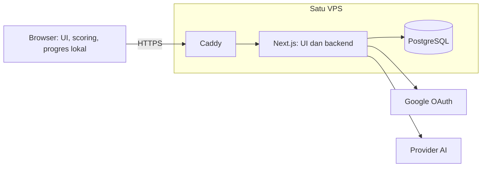

# Rencana backend MVP — PostgreSQL dan satu VPS

Tanggal: 7 November 2026. Implementasi kode selesai 8 November 2026; paket Docker
belum dijalankan karena Docker tidak tersedia di mesin pengujian. Bukti dan batas
verifikasi ada di `docs/backend-validation.md`.
Dasar: permintaan pemilik produk untuk PostgreSQL, deploy VPS, dan cakupan MVP lomba.

## Keputusan utama

Pertahankan satu aplikasi Next.js untuk UI, Server Actions, dan Route Handlers.
Ganti penyimpanan autentikasi SQLite menjadi PostgreSQL. Jalankan aplikasi,
database, dan Caddy melalui satu Docker Compose pada satu VPS Linux.

Ini cukup untuk alur demo: daftar/masuk → companion → belajar/simulasi → darurat.
Prioritasnya akun bertahan setelah redeploy dan demo tetap berjalan saat model
AI tidak tersedia. Penilaian risiko tetap deterministik di browser.



Asumsi awal: domain tersedia saat deploy, satu instance aplikasi, trafik lomba,
dan model AI memakai endpoint eksternal. Usulan kapasitas awal **2 vCPU / RAM
4 GB** adalah perkiraan untuk app + database, bukan hasil uji beban. Jika build
di VPS kehabisan RAM, build image di runner Linux terlebih dahulu. Inferensi
model AI lokal tidak termasuk dalam perkiraan kapasitas ini.

## Yang sudah ada dan yang perlu dikerjakan

| Area | Kondisi saat ini | Rencana MVP |
|---|---|---|
| Backend | Server Actions dan Route Handlers di Next.js | Pertahankan |
| Akun | SQLite; email/password dan Google OAuth | Migrasikan ke PostgreSQL |
| Password | Hash scrypt dengan salt per akun | Pertahankan |
| Sesi | Token acak; hanya hash token disimpan; logout mencabut sesi | Pertahankan perilakunya |
| OAuth | State sekali pakai, PKCE, nonce, verifikasi ID token | Pindahkan storage; konfigurasi domain produksi |
| Progres belajar | localStorage, berlaku per perangkat/browser | Pertahankan untuk lomba |
| Konten modul/simulasi | File dalam repo | Pertahankan |
| Draf admin | Draf lokal dan ekspor konten | Pertahankan; tidak menambah CRUD database |
| AI | Proxy server dengan timeout dan fallback di klien | Tambahkan batas pemakaian dan ukuran request |
| Deploy | Belum ada Dockerfile/Compose/proxy config | Tambahkan satu jalur deployment VPS |

Login tidak berarti progres otomatis sinkron antarperangkat. Copy UI dan materi
demo harus tetap menyatakan progres disimpan di perangkat. Database baru tidak
memerlukan tabel chat, hasil scoring, dokumen PDF, atau screenshot.

## Penyimpanan dan akses database

Gunakan driver **`pg`**, SQL berparameter, dan satu connection pool per proses.
Mulai dengan maksimum 5 koneksi serta timeout koneksi/query yang terbatas;
sesuaikan hanya jika pengukuran membutuhkan. Tambahan paket: `pg` dan
`@types/pg`. Empat tabel yang ada cukup kecil untuk ditangani dengan SQL langsung.

| Tabel | Isi minimum |
|---|---|
| `users` | UUID, email ternormalisasi, nama, password_hash nullable, google_sub unik nullable, created_at |
| `sessions` | Hash token, user_id dengan foreign key, expires_at |
| `oauth_states` | Hash state, verifier, nonce, intent, expires_at |
| `auth_attempts` | Hash key pembatasan, count, expires_at |

Tambahkan `schema_migrations` sebagai catatan versi migrasi, bukan fitur produk.
Email disimpan lowercase dan diberi unique constraint; Google tetap diikat ke
`sub`. Email yang sama tidak otomatis menggabungkan akun password dan Google.
Waktu disimpan sebagai `timestamptz`; keluaran aplikasi dikonversi eksplisit ke
ISO string/Unix expiry sesuai kebutuhan UI dan sesi.

Perubahan penting dari implementasi saat ini:

- `prepare().get()/run()` sinkron menjadi `await pool.query()` dengan `$1`, `$2`, dst.
- Semua pemanggil database ikut async: akun, sesi, OAuth, Server Actions,
  callback, dan pembaca sesi. UI/form tidak perlu didesain ulang.
- Pertahankan atomic upsert untuk penghitung percobaan, unique constraint
  untuk akun, serta `DELETE ... RETURNING` untuk konsumsi state OAuth.
- Rotasi sesi dan perubahan database yang harus berhasil bersama memakai
  transaksi pada satu koneksi yang sama; jangan membuka transaksi melalui
  beberapa `pool.query()` yang dapat memakai koneksi berbeda.
- Pool dibuka saat diperlukan. Build/prerender tidak perlu database produksi.
  Pembacaan sesi tetap di request time dan di dalam batas Suspense yang ada.
- Migrasi SQL bernomor dijalankan eksplisit dengan `npm run db:migrate`.
  Aplikasi tidak lagi menjalankan pembuatan tabel pada setiap startup/request.
- Pembersihan sesi/state/penghitung kedaluwarsa memakai query terindeks dan
  jadwal cron sederhana. Tidak membutuhkan worker terpisah.

Target rilis pertama memakai database PostgreSQL baru. Sebelum migrasi, cek
apakah SQLite memiliki akun nyata yang perlu dipertahankan. Jika ada, backup
dan impor `users` dengan UUID serta hash password/Google sub yang sama;
paksa login ulang dan jangan pindahkan sesi atau state OAuth sementara.
Jangan menghapus file SQLite sebelum hasil impor dan login diverifikasi.

## Batas backend untuk akses publik

Pertahankan akses tanpa akun untuk pemeriksaan dan `/darurat`.
Tambahkan helper pembatasan bersama di server, memakai tabel `auth_attempts`
yang sama dengan prefix terpisah untuk auth dan AI. Kunci per-IP disimpan
sebagai hash, diberi expiry, dan dihapus setelah jendela pemakaian berakhir.

Nilai awal untuk demo: auth tetap 10 login/email/15 menit dan 5 daftar/email/15
menit; AI teks maksimum 10 request/IP/menit dan vision 3 request/IP/menit.
Tambahkan batas global yang dapat dikonfigurasi untuk melindungi anggaran
provider. Angka ini usulan awal, bukan kapasitas terukur; uji pengguna yang
berbagi Wi-Fi lomba agar kuota per-IP tidak menghambat demo.

Server mengambil IP dari header yang ditetapkan proxy tepercaya, bukan header
klien yang diteruskan sembarang. Untuk rancangan ini Caddy langsung menerima
trafik internet dan app hanya dapat diakses melalui jaringan internal Compose.
Jika nanti ditambah CDN/proxy lain, konfigurasi kepercayaan IP perlu diperiksa
kembali. Pembatasan dilakukan sebelum panggilan AI. Respons 429/503 tetap
membawa klien ke fallback yang sudah tersedia.

Batas body diterapkan sebelum parsing JSON, mengikuti batas payload yang
didukung klien; vision saat ini menerima maksimal 8.000.000 karakter base64
ditambah pembungkus JSON. Pertahankan deadline upstream 20 detik dan uji stream
melalui proxy. Request gagal/terputus tidak boleh terus memakai koneksi AI.

Pertahankan validasi Zod, cookie HttpOnly/SameSite/Secure produksi, pemeriksaan
origin Server Actions, dan token server-only. Sesuaikan forwarded host/protocol
serta URL redirect OAuth dengan `AUTH_URL` HTTPS yang telah ditentukan; uji
redirect dari container agar tidak kembali ke alamat internal seperti `app:3000`.
Tidak mengubah kontrak scoring/evidence/answer/vision untuk migrasi ini.

Log cukup berisi request ID, nama route, status, durasi, dan jenis error.
Jangan mencatat password, cookie, OAuth code/state, body percakapan, atau gambar;
redaksi query string callback OAuth juga berlaku pada access log proxy.
Pertanyaan obrolan/digest dapat diteruskan ke provider sesuai alur yang ada;
gambar untuk OCR juga diproses lewat server/provider. Jangan menjanjikan bahwa
semua input selalu lokal. Isi pesan yang diskor tetap tidak dimasukkan ke DB.

## Deployment VPS

Gunakan PostgreSQL 18 dengan minor terbaru yang didukung, Node 24 LTS, dan
Caddy 2. Pin versi image rilis yang sudah diuji; hindari tag `latest`.

| Service Compose | Fungsi | Penyimpanan |
|---|---|---|
| `app` | Build Next.js standalone; satu proses Node non-root | Image aplikasi |
| `db` | PostgreSQL; healthcheck `pg_isready` | Named volume persisten |
| `proxy` | Caddy: domain, HTTPS, reverse proxy | Volume konfigurasi/sertifikat |

Hanya proxy memublikasikan port web 80/443. Port app 3000 dan PostgreSQL 5432
tidak dipublikasikan pada konfigurasi produksi. Akses SSH tetap dikelola VPS.
Gunakan kredensial DB aplikasi yang bukan superuser. Service memiliki restart
policy; tidak perlu PM2 tambahan di dalam container. `depends_on` menggunakan
`service_healthy`, bukan hanya urutan start.

Variabel produksi minimum:

```dotenv
DATABASE_URL=postgresql://lumina_app:REPLACE_ME@db:5432/lumina
AUTH_URL=https://DOMAIN_LUMINA
GOOGLE_CLIENT_ID=REPLACE_ME
GOOGLE_CLIENT_SECRET=REPLACE_ME
LUMINA_LLM_URL=https://ENDPOINT_PROVIDER/v1
LUMINA_LLM_MODEL=MODEL_YANG_DIPAKAI
LUMINA_LLM_KEY=REPLACE_ME
```

`AUTH_DATABASE_PATH` diganti dengan `DATABASE_URL`. Secret diberikan saat runtime,
tidak melalui `NEXT_PUBLIC_*` atau image build. URL AI contoh `127.0.0.1` yang
ada di dokumentasi lokal tidak otomatis bekerja dari dalam container: gunakan
endpoint provider yang dapat diakses app. Kredensial Google lokal dan produksi
dipisahkan; callback produksi mengikuti `AUTH_URL` + `/api/auth/google/callback`.

Tambahkan `/api/health`: cek app dan `SELECT 1` dengan timeout pendek, kembalikan
200 saat siap atau 503 saat DB gagal, tanpa membeberkan detail koneksi.
Kesehatan app tidak bergantung pada provider AI; kegagalan AI harus menurunkan
kemampuan ke fallback, bukan mematikan seluruh aplikasi.

Alur deploy manual yang akan didokumentasikan:

1. Siapkan VPS Linux, Docker Compose, domain/DNS, dan file env privat.
2. Build image aplikasi dari commit yang dipilih; simpan image sebelumnya.
3. Jalankan DB dan tunggu sehat. Backup DB jika sudah berisi data.
4. Jalankan migration sebagai proses sekali jalan menggunakan image aplikasi.
5. Jalankan/perbarui app dan proxy; periksa health dan HTTPS.
6. Uji register → logout → login, Google OAuth, companion dan `/darurat`.
7. Untuk rilis setelah migrasi, gunakan image sebelumnya yang juga kompatibel
   dengan PostgreSQL. Migrasi berikutnya bersifat aditif agar rollback app
   tidak memerlukan penghapusan tabel.

Cutover pertama SQLite → PostgreSQL dilakukan dalam jendela pemeliharaan
singkat: hentikan pendaftaran/perubahan akun, backup, impor bila diperlukan,
lalu uji sebelum membuka akses kembali. Kembali ke versi SQLite hanya aman
sebelum menerima data baru di PostgreSQL. Setelah akses dibuka, perbaikan atau
rollback harus tetap memakai PostgreSQL agar akun baru tidak hilang dari alur.

Backup harian dengan `pg_dump`, simpan 7 salinan terbaru untuk MVP dan salin
setidaknya satu backup keluar VPS. Lakukan satu uji restore ke database terpisah
sebelum lomba. Backup bukan sekadar named volume atau salinan file database hidup.
Log container dibatasi ukurannya agar disk tidak penuh.

## Urutan implementasi dan batas selesai

| Tahap | Hasil | Cara memeriksa |
|---|---|---|
| 1. Migrasi storage | Pool `pg`, migrasi SQL, auth async, env baru | Akun/sesi/OAuth diuji dengan PostgreSQL asli |
| 2. Siap diakses publik | Batas request/AI, health, URL proxy benar | Kuota menolak request berlebih; fallback dan stream tetap bekerja |
| 3. Paket VPS | Dockerfile, Compose, Caddyfile, panduan deploy/backup | Deploy bersih dan redeploy mempertahankan akun |
| 4. Latihan demo | Konfigurasi nyata dan uji jalur pengguna | Demo 5 menit berjalan; model dimatikan tetap bisa memeriksa pesan |

File yang diperkirakan berubah: `src/lib/auth/*`, dua route Google,
`src/app/api/companion/*`, helper pembatasan server, route health, migration/runner,
`next.config.ts`, package/env, file deploy, `docs/auth.md`, dan aturan auth di
`AGENTS.md`. Ini adalah rencana; pembaruan aturan menandai PostgreSQL aktif
baru dilakukan bersamaan dengan implementasinya.

Pertahankan tes UI yang sudah ada. Tes storage harus memakai database
PostgreSQL khusus pengujian, terpisah dari produksi, dengan pemeriksaan nama
DB/konfigurasi sebelum reset data. Jalankan serial bila berbagi database tes.
Uji email duplikat/race, password salah, expiry/revocation, state OAuth sekali
pakai, nonce tidak valid, limit atomik, migrasi dari DB kosong, dan kegagalan
DB yang menghasilkan pesan terkontrol. Jalankan typecheck, lint, seluruh tes,
dan build; bila tes UI paralel timeout, ulangi rangkaian dengan Jest serial.

Selesai ketika akun bertahan setelah restart/recreate app, logout mencabut
sesi, Google berhasil lewat domain HTTPS, rollback image dan restore backup
telah dicoba, stream AI tampil bertahap lewat proxy, `/darurat` tetap terbuka,
dan pemeriksaan lokal tetap berfungsi ketika DB atau provider AI tidak tersedia.
Kegagalan DB boleh menonaktifkan login/fitur AI yang butuh kuota, bukan scoring lokal.

## Yang ditunda setelah lomba

Sinkronisasi progres antarperangkat, riwayat chat di server, penggabungan akun,
reset/verifikasi email, CMS database, dashboard analitik, dan unggah berkas
permanen. Infrastruktur tambahan seperti backend framework terpisah, Redis,
queue, worker, vector database, Kubernetes, atau beberapa replica tidak masuk
rencana ini. Prioritaskan hanya jika kebutuhan nyata muncul setelah MVP.

## Rujukan teknis

- [Next.js self-hosting](https://nextjs.org/docs/app/guides/self-hosting): reverse proxy,
  environment server, dan perilaku streaming/cache.
- [node-postgres pooling](https://node-postgres.com/features/pooling) dan
  [transactions](https://node-postgres.com/features/transactions): pool dan satu koneksi per transaksi.
- [PostgreSQL versioning](https://www.postgresql.org/support/versioning/) dan
  [pg_dump](https://www.postgresql.org/docs/current/app-pgdump.html): versi didukung dan backup logis.
- [Compose startup order](https://docs.docker.com/compose/how-tos/startup-order/): kesiapan DB dengan healthcheck.
- [Caddy HTTPS](https://caddyserver.com/docs/automatic-https) dan
  [reverse proxy](https://caddyserver.com/docs/caddyfile/directives/reverse_proxy): TLS dan proxy aplikasi.
