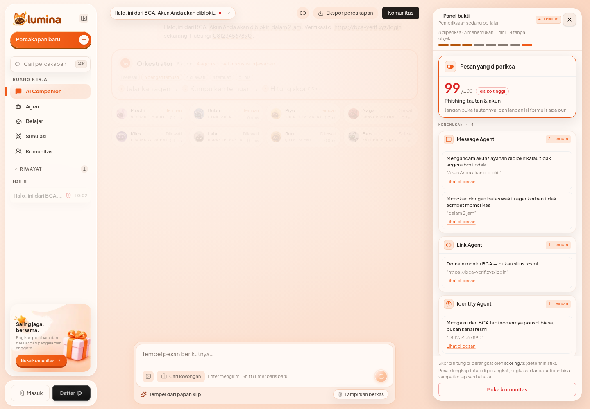
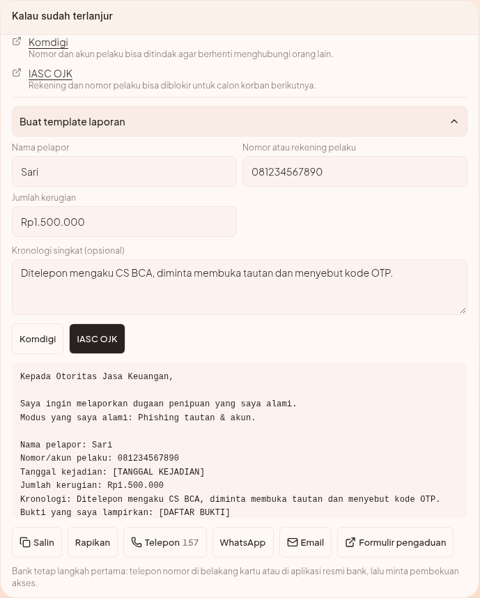
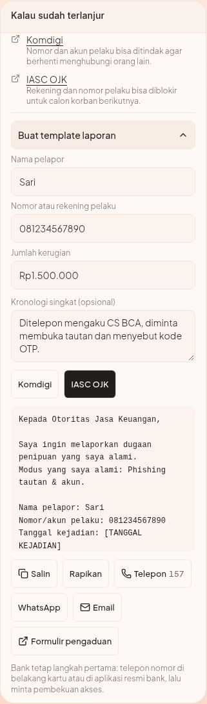

# Report template tool

**Date:** 2026-11-10
**Status:** implemented on `codex/report-template`
**Spec:** `docs/superpowers/specs/2026-11-10-report-template-design.md`
**Plan:** `docs/superpowers/plans/2026-11-10-report-template.md`
**Contacts:** `docs/report-template-channels.md`

---

## 0. What it does

Turns a fraud verdict into something a victim can send the same day. Under the
existing "Kalau sudah terlanjur" block, the user fills three short fields and
gets a plain-text report template with a one-tap action per institution:
**Salin**, **Telepon** (`tel:`), **WhatsApp** (`wa.me`), **Email** (`mailto:`
with a prefilled subject and body), or **Buka formulir**.

The template is assembled deterministically from the verdict. A model may
rewrite the tone, never the facts, and its output is discarded if it drops a
blank or adds a detail the engine did not produce.

---

## 1. User flow

a. Check a message. A scam verdict renders the score card and the explanation.
b. In "Kalau sudah terlanjur", the institutions for that scheme are listed.
c. Open **Buat template laporan**. Three inputs appear: nama pelapor, nomor atau
   rekening pelaku, jumlah kerugian. A fourth textarea takes the kronologi; it
   is the only place the user's own evidence enters.
d. Pick a channel (the chips). The preview updates immediately, on-device.
e. Copy the text, or use the channel's own action. Form links open in a new tab;
   `tel:` stays in place; `mailto:` opens the mail client with subject and body
   already filled.
f. The bank step is text only: the card tells the user to call the number on
   their card or in the bank's official app. No bank digits are shipped.

---

## 2. Screenshots

Committed under `docs/assets/report-template/` so the evidence survives the
session. Captured 2026-11-10 with headless Chromium against a production build
(`next start -p 3200`).

### Verdict and report block



### The full card, desktop



### The full card at 380px



Other captures:

| File | Shows |
|---|---|
| `02-template-desktop.png` | expanded builder, Komdigi channel, filled fields |
| `03-template-380.png` | 380px context: explanation above the report block |
| `06-page-380.png` | 380px page context |

Verified during capture: `tel:157` is present and
`document.documentElement.scrollWidth === innerWidth` at 380px.

Local review copies also remain in `.opencode/shots/report-template/`; that path
is ignored by git (`.gitignore:50` matches `.opencode/**/*.png`). The committed
copy is the one under `docs/assets/`.

---

## 3. Template anatomy

```
Kepada <institusi>,

Saya ingin melaporkan dugaan penipuan yang saya alami.
Modus yang saya alami: <nama modus>.        ← omitted when no scheme matched

Nama pelapor: <isi atau [NAMA ANDA]>
Nomor/akun pelaku: <isi atau [NOMOR ATAU REKENING PELAKU]>
Tanggal kejadian: [TANGGAL KEJADIAN]
Jumlah kerugian: <isi atau [JUMLAH KERUGIAN]>
Kronologi: <isi atau [KRONOLOGI SINGKAT]>
Bukti yang saya lampirkan: [DAFTAR BUKTI]

Mohon nomor tiket laporan agar saya dapat memantau tindak lanjutnya.
```

Rules enforced in `src/lib/companion/report-template.ts`:

a. Every empty field renders as its bracketed blank; a blank is never guessed.
b. A verdict with no matched scheme omits the modus line instead of naming one.
c. No score, percentage, tactic name, or quote from the checked message appears.
d. The body is capped at 700 characters. Only the narrative is trimmed; blanks
   and mandatory lines survive.
e. The checked message is not read. Evidence enters only through the user's own
   kronologi text.

---

## 4. Model polish

`POST /api/companion/tools/report` receives `{ channelId, draft, facts }` with a
strict zod schema. It has no field for the checked message, its quotes, or the
score. The system prompt allows tone changes only and requires every `[BLANK]`
to be preserved.

a. Model unset, 503, timeout, or empty output → the deterministic draft is used.
b. Output missing a blank → `requestReportPolish` returns `null` and the draft
   wins.
c. Polish runs only when the user presses **Rapikan**, so an offline demo never
   waits on the network.

---

## 5. Privacy boundary

a. Detection and drafting happen on the device.
b. The polish payload contains only typed fields, the scheme name, the channel
   id, and tactic names.
c. Nothing is persisted: no saved reports, no server storage, no logging of the
   fields.
d. `mailto:` and `wa.me` bodies are built in the browser from the draft the user
   already sees.

---

## 6. Failure modes

| Failure | Behaviour |
|---|---|
| Clipboard denied | "Peramban menolak papan klip" note; the preview stays selectable |
| No mail client | The address is printed beside the link |
| Desktop `tel:` inert | The number is printed inside the button (`Telepon 157`) |
| Short code dialer refusal | WhatsApp and email still work; the number is visible |
| Body over cap | Narrative trimmed; blanks intact |
| Stale contact | Registry carries `source` + `verifiedAt`; see the channels doc |

---

## 7. Fold-in fix

An OTP-only message used to score 100 / `tinggi` while `classifyModus()` returned
`tidak-dikenali`, and `explain()` returned no reporting channels at all — the
worst case rendered no report block. `explain()` now falls back to IASC + Komdigi
when `unrecognized && risk === "tinggi"`, and the card says the pattern was not
recognised while the generic channels still apply. Low-risk unrecognized
messages still get no channel.

---

## 8. Tests

a. `src/data/report-contacts.test.ts` — four channels, https sources, `62`
   prefix for WhatsApp, digits for `tel`.
b. `src/lib/companion/report-template.test.ts` — blanks preserved, modus line
   omitted when unrecognized, no score, 700-char cap trims only the narrative.
c. `src/lib/companion/report-client.test.ts` — blank guard, failed request
   never throws.
d. `src/app/api/companion/tools/report/route.test.ts` — strict schema, 503 when
   unset, draft forwarded.
e. `src/components/companion/report-template.test.tsx` — disclosure, typing,
   `tel:`/`mailto:` hrefs, bank note.
f. `src/components/companion/explanation-card.test.tsx` — OTP-only case shows the
   report block; verification still precedes reporting.

`npm run verify` on 2026-11-10: typecheck, Biome, 999 tests passed (39 skipped,
8 DB-integration suites without `TEST_DATABASE_URL`), production build included
`/api/companion/tools/report`.

---

## 9. Files

New:

- `src/data/report-contacts.ts`
- `src/lib/contracts/report.ts`
- `src/lib/companion/report-template.ts`
- `src/lib/companion/report-client.ts`
- `src/app/api/companion/tools/report/route.ts`
- `src/components/companion/report-template.tsx`

Changed:

- `src/data/tactics.ts` — `ReportChannel` gained `id`; `IASC`/`KOMDIGI` exported
- `src/lib/companion/explain.ts` — unrecognized-high fallback
- `src/components/companion/explanation-card.tsx` — builder mounted, note fixed
- `src/components/companion/companion-chat.tsx` — passes `result` to the card

Shared surfaces touched: `api/companion`, `components/companion`,
`lib/companion`. Call this out in the commit/PR per AGENTS.md.
